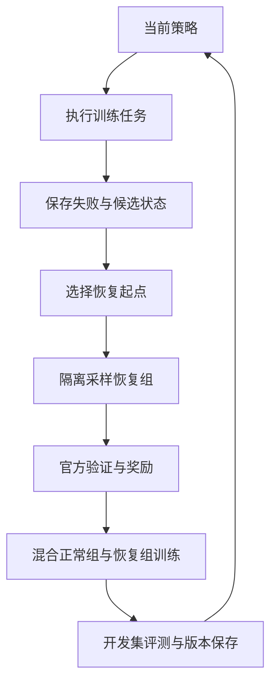

# RecoverAgent-RL：项目计划与需求文档

> 英文名称：Self-Improving Tool Agents through Failure Recovery  
> 版本：v0.2  
> 创建日期：2026-10-19  
> 状态：设计稿；尚未在目标开发环境中完成安装、真实运行或训练验证。  
> 使用对象：项目负责人、负责实现与实验的 Codex。  
> 配套文件：项目根目录的 `AGENTS.md`。

## 0. 如何使用这份文档

本文件是项目的需求与实施依据，后续根据实际代码、环境能力和实验结果修改。它规定目标、默认方案和验收条件，不预先宣称算法有效，也不代表文档中列出的程序已经存在。

**用户已确定的训练路线：先完成 Teacher 恢复示范构建与 Student SFT，再进入 GRPO。Teacher SFT 是必经阶段，不能根据基座成功率、工期或预算将其自行改回可选。**

开始实现时，先阅读 `AGENTS.md` 和本文件，再检查现有仓库。如果已有代码或阶段报告，应从已经验证的状态继续；不要重新搭建已经完成的部分。首次实现时创建 `docs/STATUS.md`，记录当前阶段、证据、阻塞和下一步。

全文约定：

- **已确定**：当前项目方向，修改时需要记录原因，并遵循用户后续决定。
- **默认方案**：可以根据兼容性、资源和预实验调整，不需要为常规技术取舍逐项询问。
- **待验证假设**：实验问题，不是已经成立的结论。
- **拟实现接口/命令**：本项目计划新增的能力，不能当作上游现成 API。
- **阶段验收**：推进工作的证据条件，不是每一步重新请求确认的要求。

### 当前执行入口

首次收到“开始实现项目”的指令时，默认完成 **P0–P2 的最小闭环**：

1. 检查环境与已有代码，锁定 AppWorld 版本。
2. 跑通一个能执行真实工具调用的 Agent。
3. 采集至少一条自然产生的失败轨迹。
4. 保存对应环境状态、合法对话历史和工具配置。
5. 从相同失败起点完成四次隔离的恢复尝试。
6. 得到四份可由官方验证器核查的结果与阶段报告。

**首轮 P0–P2 默认不启动训练。** 用户授权推进训练后，依次完成 P3-A Teacher 示范构建、P3-B Student SFT、P3-C GRPO，不得跳过 Teacher SFT。如果本次请求仅为修改文档，则只修改文档。

## 1. 项目定位与动机

### 1.1 要解决的问题

多步骤工具任务中，一次错误不仅会产生错误文本，还可能改变后续执行所依赖的状态。例如，Agent 更新了错误对象，重复创建记录，或者在未满足前置条件时执行下一步。后续决策需要理解已经发生的操作，检查当前状态，再选择继续、修正或补偿。

本项目研究：**如何把当前 Agent 自己产生的失败，转换成可执行、可验证、可持续更新的训练任务，使同一个策略模型提高正常任务执行与错误后恢复的能力。**

以 AppWorld 的有状态、多应用任务作为实验载体。业务示例用于说明问题，不代表接入了真实企业系统，也不代表已经具备生产部署能力。

### 1.2 基础方法与拟研究增量

基础方法借鉴 ReTerm，分为两个连续训练阶段：先由基座生成自然失败，让更强 Teacher 从保留的状态与历史中完成恢复，筛选示范并进行 Student SFT；随后让当前 Student 从同一起点生成多条恢复后缀，利用真实验证结果进行组内比较，混合正常任务与恢复任务做 GRPO。[S4][S5]

本项目拟研究两个增量：

1. **Decision-Point Recovery（恢复起点选择）**：从失败轨迹中的有限候选检查点选择训练起点，比较它与仅从失败终态附近恢复的效果。
2. **Adaptive Failure Learning（自适应失败经验学习）**：根据当前策略对失败起点的恢复表现，调整经验采样，同时保留探索和旧经验覆盖。

“失败后分叉 + GRPO”属于已有方法基础。中间状态恢复也已有相关分析；本项目不宣称首次提出这些概念。增量是否成立，需要用固定预算下的对照、消融和误差分析证明。

### 1.3 自迭代的含义

这里的自迭代是受控训练循环：当前模型执行训练任务，产生新的失败经验，再通过训练更新参数。每轮重新采样，并保留模型版本与开发集结果。

它不要求增加独立的反思模型、诊断模型或记忆 Agent，也不意味着部署期间无限在线更新。

## 2. 目标、范围与成功标准

### 2.1 分层目标

| 目标层级 | 必须完成的结果 | 能支持的结论 |
| --- | --- | --- |
| 基础设施版本 | 一条真实失败 → 状态与历史复现 → 四次恢复 → 官方验证 | 环境与采样机制可用 |
| 最低训练版本 | 完成 Teacher 恢复示范筛选与 Student SFT，再由 SFT 后策略生成恢复组并完成真实 GRPO 更新，保存并重载 checkpoint | 两阶段训练管线可用；不自动代表能力提升 |
| 完整项目版本 | 两项方法增量、至少两轮完整更新、公平基线与消融、可复现实验报告 | 可以评价方法是否有效及其局限 |
| 可展示版本 | 固定案例的执行/恢复轨迹、关键指标、复现入口和来源说明 | 可用于简历与面试解释 |

项目完成的标准是交付可信的实现和实验。正向提升是研究目标，不是保证；负结果同样保留，并用于决定简化或调整方法。

### 2.2 当前已确定的范围

- 环境只使用 **AppWorld**。
- 只训练一个 Student 策略模型，默认从 Qwen3 小模型开始；另使用参数固定的更强 Teacher 生成恢复示范。
- Teacher 恢复 SFT 为主训练流程的强制前置，所有主线 RL 方法使用同一份通过验收的 SFT checkpoint 初始化。
- 主训练数据来自 Agent 在 `train` 上的自然失败。
- 初版采用文本与结构化工具调用，不做网页视觉或多模态交互。
- 先实现串行隔离恢复，再根据瓶颈增加并发。
- 正常任务与恢复任务共同服务于最终完整任务能力。
- 最终正常评测时，Actor 只能使用任务允许的工具，不能调用环境回滚或隐藏验证器。

### 2.3 首版不纳入的内容

- AWM、自动环境生成、第二套环境迁移。
- 独立 Failure Diagnoser、Fault Evolver、Memory Agent 等多模型系统。
- 以人工注入故障替代自然失败作为主实验数据。
- 直接迁移 ReTerm 的完整分布式训练栈。
- 大规模多卡训练、前端平台、真实业务部署。
- 缺乏可验证定义的安全评分或复杂过程奖励。

这些内容不妨碍未来扩展，但不能阻塞当前闭环。

### 2.4 技术选择与可调整参数

| 项目 | 首版默认 | 调整依据 |
| --- | --- | --- |
| 环境运行方式 | AppWorld 本地 Unified 模式 | 官方兼容性及目标机器能力 |
| Agent 接口 | 原生 Function Calling 的交互方式 | 选定版本的实际接口 |
| 策略模型 | `Qwen/Qwen3-4B` 候选 | 显存、上下文与工具调用预实验 |
| 资源不足时 | 可退到 Qwen3-1.7B 验证流程 | 不能把弱模型全失败误判成方法失效 |
| 恢复组大小 | 4 | 吞吐、奖励差异和预算 |
| 环境并发 | 1，四分支串行 | 隔离通过后再提高 |
| 正常/恢复训练组比例 | 1:1 | 任务能力保持与开发集结果 |
| 初始奖励 | 官方严格任务成功的 0/1 信号 | 成本/安全项需另行验证 |
| 参数训练 | LoRA | 先测显存，不承诺特定单卡一定可运行 |
| 训练框架 | 优先评估 TRL，必要时接自定义 rollout | 多轮轨迹、分组、mask 和 worker 契约是否满足 |
| Teacher SFT | 必须完成；更强 Teacher 生成恢复示范，Student 接受 SFT | Teacher、样本规模与训练参数可调整；该阶段不可跳过 |

## 3. 上游依据与必须核验的工程事实

资料核对日期为 2026-10-19。以下记录用于避免沿用未经验证的旧接口；实际开发仍需固定版本并运行验证。

### 3.1 AppWorld

- AppWorld 提供数据库状态保存/加载、任务 API 与状态验证；官方支持 `train`、`dev`、`test_normal`、`test_challenge` 四个划分。[S1]
- 当前核对的源码版本为 `42b5bcf3cd334fee33f0c37c02070a9f5807add5`。这只是文档核对版本，不是项目已经安装的版本。[S2]
- 在该版本中，`save_state()` 无参保存默认输出状态并返回 `None`；显式传入 `state_id` 才生成命名检查点。`load_state(state_id)` 在当前 world 的检查点目录查找该 ID。[S2]
- 新 world 初始化会准备自己的输出目录。不能把原始快照放在可能被重新初始化覆盖的目录中，也不能假定另一个 worker 可以直接使用源 world 的 ID。[S2]
- Unified 模式下，并行独立 world 需要进程隔离；每个执行分支应有唯一输出身份。线程或多个 Python 包装对象不足以证明隔离。[S3]
- 状态恢复不能被视为完整 Agent 快照：messages、工具列表、调用 ID、运行时变量、计数器和其他状态都需要单独管理或证明不影响后续执行。[S2][S3]

同一个 world 内的接口示意如下；这不是跨进程恢复实现：

```python
state_id = "checkpoint_005"
world.save_state(state_id)
# 执行待验证的真实状态修改后，再在同一 world 恢复。
world.load_state(state_id)
```

不要继续使用 `checkpoint = world.save_state()` 后把返回值直接传给 `load_state()` 的旧示例。

### 3.2 ReTerm 与训练框架

ReTerm 的恢复队列、同起点分叉和正常/恢复混合训练作为方法参考。这里实现的是 **AppWorld 上的 ReTerm-style baseline**；除非逐项复现模型、数据、训练器与配置，否则不称为完整复现 ReTerm。[S4][S5]

当前 TRL 文档提供工具、多轮环境与自定义 rollout 接口，但环境相关接口仍带有实验性约束。文档中的 `environment_factory` 要求特定依赖版本，并可能自动暴露环境的公开方法。是否采用它，必须通过本项目的分组、进程隔离和工具白名单验证。[S6]

不要把 `load_task/reset/restore/snapshot/evaluate` 之类的项目能力需求写成已经核对的 ReTerm 精确方法签名。若选择其适配器，先读取固定 commit 的真实协议。

### 3.3 版本记录要求

P0 产生 `reports/environment_report.md` 和机器可读版本记录，至少包括：AppWorld package/commit、数据版本、Python、PyTorch/CUDA（若使用）、Transformers、TRL、PEFT、推理后端、模型与 tokenizer revision、chat template 哈希、设备与资源上限。

未知项写 `NOT_CHECKED` 或 `NOT_INSTALLED`，不能填猜测版本；训练前必须补全实际使用项。

## 4. 基本概念与执行协议

### 4.1 术语

| 术语 | 本项目含义 |
| --- | --- |
| Actor / Policy | 生成任务决策与工具调用的可训练模型 |
| 正常 rollout | 从官方原始任务状态执行的一次完整尝试 |
| 决策回合 | 一次模型生成；与工具调用数分开计数 |
| 工具调用 | 一次实际尝试分发的 API 调用，包括失败调用 |
| 训练更新步 | 一次优化器更新，与 Agent 执行步数无关 |
| 失败记录 | 原任务、源策略、失败轨迹、可恢复起点及离线评价的组合 |
| 恢复起点 | 某个环境状态与同一时刻的可见历史、工具配置的组合 |
| 恢复后缀 | 从恢复起点以后由当前策略新生成的交互 |
| 恢复组 | 同一起点下的 G 条独立恢复后缀，默认 G=4 |
| 自迭代轮次 | 采集新失败、生成训练数据、更新、开发集评测的一次循环 |

### 4.2 必须分开的三种协议

| 协议 | 起点 | 可以证明什么 |
| --- | --- | --- |
| 正常任务执行 | 原始任务状态 | 固定预算下的完整执行能力 |
| 错误后恢复 `post_action` | 错误已经发生的状态，保留其后果 | 能否检查并修补已有错误 |
| 错误前重新分支 `pre_action` | 错误动作尚未发生的状态 | 能否通过另一条决策路径避免错误 |

`pre_action` 是反事实训练，不直接记作“修复了已经发生的错误”。两类数据可以用于训练，但恢复评测必须分开报告。

如果动作 `a_t` 将状态 `s_t` 变为 `s_{t+1}`，那么恢复到 `s_t` 时只能使用执行 `a_t` 之前的历史；恢复到 `s_{t+1}` 时才可以包含它的工具结果。不能混入未来观察。

对于错误宣布完成的任务，可以选择 `complete_task` 之前的状态作为 `pre_termination` 起点，同时截断历史中的终止动作及以后内容，并记录该协议选择。

### 4.3 Actor 可见信息

Actor 可见：任务指令、允许公开的任务信息、可用工具文档、自己此前的决策与真实工具返回、统一的继续执行提示。

训练控制器可以读取：官方验证结果、快照、数据库一致性信息、组内奖励、经验统计。这些内容不自动成为 Actor 输入。

Actor 不可见：隐藏测试、标准答案、目标数据库状态、详细验证失败断言、后续轨迹、其他分支结果、状态管理和评估接口。

默认恢复提示只要求从已有状态继续，避免重复已完成操作，不说明哪个隐藏测试失败。如果后续实验加入“上一轮未通过验证”的告知，必须记录为额外失败通知，所有恢复基线使用同样信息；不能据此宣称 Actor 自主发现了隐藏错误。

### 4.4 整体闭环

进入下图循环前，必须先完成 Teacher 示范构建、筛选和 Student SFT，得到初始策略；具体流程见第 8.5 节。下图表示随后的训练控制流程，不是向 Actor 暴露的工具图。



## 5. 功能需求与模块职责

| 编号 | 模块 | 必须提供的能力 | 首次交付阶段 |
| --- | --- | --- | --- |
| FR-01 | AppWorld Adapter | 创建/关闭 world，执行合法工具，获取任务信息 | P0 |
| FR-02 | Agent Runner | 正常执行、格式校验、预算控制、完整历史 | P0 |
| FR-03 | State Manager | 命名快照、导出/导入、历史配对、一致性验证 | P0–P2 |
| FR-04 | Failure Collector | 分类自然失败，排除基础设施故障，保存候选点 | P1 |
| FR-05 | Failure Buffer | 持久化起点与来源，去重、容量管理、版本追踪 | P1 |
| FR-06 | Recovery Runner | 同起点 G 次恢复，隔离目录/状态，输出完整结果 | P2 |
| FR-07 | Reward / Evaluator | 官方严格成功、成本统计、可选验证过的安全项 | P2 |
| FR-08 | Training Bridge | Teacher 后缀 SFT 的 loss mask、多轮 token/logprob/mask 对齐、GRPO 更新、权重同步 | P3-B–P3-C |
| FR-09 | Selectors | 恢复点选择、经验采样、统计更新 | P4 |
| FR-10 | Self-Improve Loop | 多轮采集、训练、评测、断点续跑 | P4 |
| FR-11 | Evaluation | 完整任务、固定恢复池、预算曲线、消融 | P3–P5 |
| FR-12 | Reproducibility | 配置快照、随机种子、版本、原始数据与报告 | 全阶段 |
| FR-13 | Teacher Recovery Dataset | Teacher 接手自然失败、真实执行恢复、四类质量过滤、示范与来源清单 | P3-A |

Adapter 的状态管理能力是训练控制面的接口。不能为了方便，把 Adapter 的所有公开方法直接注册成模型工具。尤其采用 TRL 环境自动工具暴露时，必须检查实际 tool schema。[S6]

### 5.1 Agent Runner 约束

- 复用或参考 AppWorld 官方 Function Calling Agent 的工具映射方式。[S7]
- 初版默认一个模型回合只执行一个工具调用；如果上游支持多调用，必须在完整工具批次边界建立检查点，并保证每个调用 ID 有相应结果。比较方法使用同一约定。
- 不在 Runner 中按任务答案硬编码工具步骤，不自动替模型完成任务相关登录或业务操作。[S1]
- 工具参数使用结构化解析与类型校验；不要把不受约束的模型字符串拼入执行代码。
- 动态工具选择的结果也属于恢复上下文；恢复时不能悄悄给某个分支增加正确工具。
- `complete_task` 表示 Agent 结束尝试，不等于官方验证成功。
- 记录生成回合、请求调用、实际执行调用、输入/输出 token、耗时及终止原因。

### 5.2 State Manager 约束

每个可恢复起点至少包含：数据库快照及依赖版本、原始 task ID、历史前缀、工具 schema、执行边界、任务时钟与必要运行时信息、预算协议、配置哈希。

快照应移入独立于临时 world 输出目录的不可变存储。新 worker 完成 world 初始化后，再通过选定版本支持的方式导入快照；不能只跨进程传一个未经解析的 ID。

数据库快照可能依赖 AppWorld 基础数据库与增量格式。需要保留基础数据版本，不能默认单个目录可脱离原始数据独立恢复。[S2]

一致性以稳定的逻辑状态指纹为主，例如按固定顺序读取并规范化相关表内容。不要把 SQLite 文件字节相同当作唯一正确性标准。Actor 不得访问这些检查信息。

## 6. 数据、快照与信息隔离

### 6.1 分离三类文件

| 数据 | 用途 | 可进入模型输入 |
| --- | --- | --- |
| Actor 历史、工具文档 | 复现实际可见上下文 | 是，经过边界检查 |
| 环境快照与恢复元数据 | 控制环境起点 | 否 |
| 官方评估、奖励与诊断 | 训练反馈和研究分析 | 不作为文本提示；奖励仅进入优化器 |

历史必须保存原始形式；若需要截断或压缩，另外生成带版本的模型输入记录，保留所用规则和映射。早期优先使用固定截断策略，不增加摘要模型。训练计算概率时使用各回合实际生成所见的上下文窗口，不能用未截断的整段历史代替原采样条件。

### 6.2 最小记录契约

以下为本项目拟定字段，不是 AppWorld 自带数据结构。

**轨迹记录：**

| 字段 | 要求 |
| --- | --- |
| `run_id`, `trajectory_id`, `task_id`, `split` | 唯一运行身份及原任务划分 |
| `policy_id`, `model_revision`, `adapter_revision` | 可追踪到采样时的实际权重 |
| `messages`, `tool_schema_ref` | 完整合法历史及当时可见工具 |
| `events` | 每次生成、调用、观察及其顺序 |
| `checkpoints` | 有效执行边界上的状态与历史引用 |
| `termination_reason` | 完成声明、预算、工具循环、基础设施错误等 |
| `usage` | 输入/输出 token、调用数、时长、恢复新增成本 |
| `evaluation_ref` | 仅指向控制侧评价文件 |

**失败/起点记录：**

| 字段 | 要求 |
| --- | --- |
| `failure_id`, `source_trajectory_id`, `source_policy_id` | 失败的来源，不随重采样覆盖 |
| `task_id`, `split`, `scenario_id` | 场景字段按实际元数据解析，未知不能编造 |
| `checkpoint_id`, `snapshot_ref`, `snapshot_hash` | 不可变快照引用及完整性校验 |
| `checkpoint_position` | `post_action` / `pre_action` / `pre_termination` / `budget_exhausted` |
| `history_ref`, `history_end_index`, `history_hash` | 与状态同一时刻的历史 |
| `tool_schema_hash`, `runtime_ref` | 工具可见范围及必要运行时状态 |
| `failure_type`, `candidate_reason` | 区分观察到的信号与推断原因 |
| `recoverability_status` | `unknown` / `observed_success` / `no_success_observed` / `proven_blocked` |
| `stats` | 当前估计所属策略、尝试数、成功数、最后刷新轮次 |

**恢复组记录：**

- `group_id`、起点记录 ID、行为策略版本、统一恢复提示哈希、统一预算。
- G 个不同采样种子、每条后缀的轨迹引用、真实 reward 及有效性状态。
- 起始状态/历史/tool schema 指纹与隔离检查结果。
- 训练阶段再补全 token IDs、行为 log probabilities、生成位置 mask、模板版本与统计信息。

同组键应覆盖 task、起点状态、历史、工具、提示与预算；仅采样随机性不同。不同检查点不能混为同一个 GRPO 组。

### 6.3 失败类型与入池规则

| 类型 | 处理方式 |
| --- | --- |
| 工具参数/权限等局部错误 | 记录为候选信号；Agent 后来成功则不自动算整任务失败 |
| 最终官方任务失败 | 进入自然失败候选池 |
| 可核验错误状态修改 | 标注证据；不能把所有状态修改都称作错误 |
| 预算耗尽 | 独立标签；恢复获得的额外预算必须统计 |
| 过早宣布完成 | 保留原失败，使用合法的终止前起点协议 |
| 四次恢复均失败 | 标为当前采样未发现成功，不能直接标不可恢复 |
| 明确不可继续的状态 | 保存可核查原因；不靠主观判断永久淘汰 |
| 环境进程/通信/数据库基础设施错误 | 单独计数与有限重试，不作为策略失败奖励 |

入池去重以源任务、状态、历史和配置联合身份为依据。不同历史即使数据库相同，也不随意合并为同一起点。

## 7. 恢复采样与隔离协议

### 7.1 一个恢复组的执行过程

1. 读取一个不可变起点记录并验证版本与文件完整性。
2. 固定行为策略、工具配置、恢复提示与 G 个采样种子。
3. 为当前分支创建唯一执行身份和干净的环境 worker。
4. 导入快照，恢复同一合法历史与必要运行时信息。
5. 核对起始逻辑状态、历史和工具指纹。
6. 让当前策略执行恢复后缀，直到终止或达到预算。
7. 在验证前保留后缀终态，运行官方任务评估，写出结果。
8. 关闭 worker，检查源快照未改变，再执行下一分支。

初版 G=4，按上述过程串行运行。独立恢复不要求并行运行。以后采用多个 worker 时，模型推理服务可以共享，但环境状态和输出身份必须隔离；不要在每个 CPU worker 重复加载整份模型。

### 7.2 官方评估的参照状态

恢复后的任务成功仍按**原始 task 的指令、初始参照和官方验证规则**判断。不能把损坏的失败快照重新定义成任务的干净初始状态，使此前错误修改逃过验证。

如所用版本的评估会影响运行状态，应在副本上执行，或在验证前保存精确终态；禁止让验证器产生的观察或状态变化进入下一条恢复轨迹。

### 7.3 基础设施验收与学习条件分开

基础设施通过要求：四个分支起点一致、互不污染、均有可解释终止和真实评价。四条奖励完全相同，也可以通过这一层验收。

GRPO 学习条件要求：完成强制 Teacher SFT 后，在 SFT 后 Student 的多个真实恢复组中观察到足够的奖励差异。P0–P2 的基座采样用于诊断，不决定是否进行 Teacher SFT。开始 Teacher 示范构建与 SFT 不要求基座事先产生混合奖励组；若 SFT 后仍长期全失败，应检查格式、工具覆盖、预算和示范质量，再调整训练与采样。

禁止人为篡改奖励、强制某分支成功，或把重复结果误报为不同结果来通过验收。

## 8. 方法设计

### 8.1 基线：ReTerm-style Recovery GRPO

使用相同策略从正常任务起点和失败起点采样。失败起点默认取最终失败附近的合法可执行状态；错误完成时按 `pre_termination` 处理。

恢复池先实现有限容量和近期失败优先策略；另提供均匀采样用于分析。默认训练正常组与恢复组各占一半，组内独立计算优势。[S4]

缓存的是“任务 + 起点状态 + 历史”。每次更新前的恢复后缀由当前行为策略重新生成，不把任意旧恢复轨迹当作当前策略在线样本。

### 8.2 改进 A：Decision-Point Recovery

**假设 H1：** 在相同总采样预算下，选择轨迹中的候选恢复起点，比只从失败终态附近训练，更能提升固定预算下的完整任务成绩或样本效率。

首版设计保持简单：

1. 每条失败轨迹最多保留三个有效候选起点，包含终态附近起点。
2. 额外候选来自可观测工具错误或重复无进展的附近边界。
3. 主实验优先使用 `post_action` 候选；`pre_action` 作为明确标记的扩展消融。
4. 先实现候选中均匀选取，再考虑基于恢复统计选择。不要一次同时改候选生成和复杂打分。
5. 不将“出现工具错误的位置”直接称为已识别的根因。

早期错误点可能更容易恢复，也可能只是提供了更长的剩余预算。因此须记录原轨迹位置、已消耗成本和新增恢复预算；完整任务主评测预算保持一致。

若为选择候选额外做恢复探测，所有探测的生成 token 与工具调用都计入预算。优先复用已经采样的结果更新统计，减少重复探索。

### 8.3 改进 B：Adaptive Failure Learning

**假设 H2：** 在保持新失败和旧经验覆盖的前提下，优先采样当前策略有成功也有失败的起点，可以增加有区分度的训练组，从而改善样本效率。

先定义：`z` 为一个起点；`n_z` 为当前统计窗口中的有效恢复次数；`s_z` 为其中成功次数。使用简单平滑估计：

$$
\hat p_z = \frac{s_z+1}{n_z+2}.
$$

再定义启发式分数：

$$
U_z = 4\hat p_z(1-\hat p_z).
$$

它是二元结果差异的代理，不是已经证明的学习收益或信息增益。四次试验的估计很粗，因此必须保存样本数和策略版本。

令 `F` 为当前可采样起点集合，`q_recent(z)` 为最近一批新起点上的均匀分布，`q_value(z)` 为按 `0.05 + U_z` 归一化的分布。第一版混合采样为：

$$
P(z)=0.2\frac{1}{|F|}+0.2q_{\mathrm{recent}}(z)+0.6q_{\mathrm{value}}(z).
$$

上述比例是默认超参数，可在 `dev` 上调整。没有新起点时，将近期项权重并入全池均匀项；新起点没有统计时使用平滑先验，不能永久饿死。旧策略统计必须标明版本，过期后刷新或回退先验，不能当作当前能力估计。

只将经验选择用于训练池，不用测试失败或测试细项指导采样。

### 8.4 初始奖励与可选扩展

令 `S_i` 表示第 i 条轨迹是否通过官方严格任务验证，取值为 0 或 1。P2–P3 的默认奖励：

$$
R_i = S_i.
$$

调用数、安全事件和重复操作先作为统计指标，不急于加入奖励。

若后续启用扩展，先定义：`V_i` 是已经独立验证的违规成本并归一化到 [0,1]；`K_i` 是恢复后缀实际尝试分发的调用数；`B` 是调用预算；`C_i=min(K_i/B,1)`；`lambda`、`mu` 是非负权重。候选形式：

$$
R_i=S_i-\lambda V_i-\mu C_i.
$$

必须满足有界成本与清晰的奖励排序，例如采用 `lambda + mu < 1`，避免失败并立即放弃获得高于成功轨迹的奖励。该约束只解决成功/失败排序，不证明过程奖励设计合理。

安全扩展需满足：

- 不把数据库差异、所有写操作或 `no_op_pass` 标签直接等同于违规。
- 区分失败前缀已经存在的损害、恢复新增损害和任务要求的合法修改。
- 记录检测覆盖范围；没有判定器时标 `NOT_MEASURED`，不能记零风险。
- 官方终态验证未必覆盖所有临时副作用，不能宣称完备安全。
- 说明安全扣分是否与官方严格成功重叠，单独做消融。

安全反馈是选配研究项，不作为完成两项核心增量的前置条件。

### 8.5 强制 Teacher SFT 冷启动

Teacher SFT 是用户明确要求的第一阶段训练。无论基座是否已经能成功恢复，主线均须先完成本节，再进入 GRPO。P0–P2 先提供真实执行、快照和隔离基础设施，本身不替代 SFT。

**角色：** Student 是本项目接受参数更新的 Qwen Agent；Teacher 是经预实验确认具备更强恢复能力的模型，只负责生成示范，其参数保持固定。选择 Teacher 时记录模型标识、版本、可用接口与预算，不根据名称直接宣称其在本环境更强。

#### 8.5.1 必须执行的五步

1. **基座执行并产生自然失败。** Student 在 AppWorld `train` 上实际执行任务，保留失败轨迹；已有 P1 数据可复用，不必重复采集。
2. **保存失败状态与合法历史。** 保留数据库快照、工具配置和同一时刻的历史前缀；Teacher 从该状态继续，继承已有操作后果。
3. **Teacher 实际完成恢复。** Teacher 通过允许的任务工具检查、修正并继续任务，直到终止或预算耗尽；仅输出恢复建议不能算执行示范。
4. **筛选恢复示范。** 删除未通过官方任务验证、格式错误、存在已证实约束违规或明显无效重复循环的轨迹，保留筛选原因和原始证据。
5. **训练 Student。** 以任务、失败历史和简短恢复提示为上下文，只对 Teacher 恢复后缀中 Assistant 生成的 token 计算 SFT loss。[S4][S5]

初期先验证少量示范，再以约 100–300 条合格 Teacher 恢复轨迹作为可调整的数据目标；具体规模根据质量、覆盖和预算记录决策。规模可调整，但不能以未生成 Teacher 示范、仅做数据准备或未执行 SFT 代替本阶段完成。

#### 8.5.2 数据与 loss 范围

| 样本部分 | 作为 Student 的上下文 | 直接计算 SFT loss |
| --- | --- | --- |
| 任务指令、恢复提示 | 是 | 否 |
| 基座失败前缀中的 Assistant 操作与工具返回 | 是 | 否 |
| Teacher 恢复阶段生成的 Assistant 文本、工具名与参数 | 是 | 是 |
| Teacher 执行期间得到的工具返回 | 是 | 否 |

训练样本须记录失败来源、Student 源策略、Teacher 标识与版本、生成配置、恢复提示版本、官方验证与质量过滤结果、数据划分和 loss mask。保留原始采集轨迹；若精简 Teacher 的采集提示，另存 SFT 输入版本，确保提示中没有目标答案、隐藏测试或额外特权。

必需的核心示范由更强 Teacher 生成，不能用 Student 自生成恢复轨迹替代这一要求。后续 Student 数据可服务于在线 GRPO 或另行标明的补充实验。SFT 示范不要求同一起点固定采样四条；四条组内比较是后续 GRPO 的采样协议。

ReTerm-10K 是终端恢复数据；本项目采用其数据构建思想，在 AppWorld 中重新构建 Teacher 恢复示范，不直接把终端格式当作 AppWorld 工具数据。[S4]

#### 8.5.3 SFT 完成验收

- 合格示范来自 `train` 上的自然失败与 Teacher 真实恢复，四类筛选可核查，质量存疑的样本待复核后再入集。
- 训练输入与 loss mask 经过抽样核对，只监督 Teacher 的 Assistant 恢复后缀。
- Student 完成真实 SFT 参数更新，保存数据清单、配置、loss、可训练参数变化与资源消耗。
- 保存并重新加载 SFT checkpoint，完成固定开发协议评价；不把一次更新或 loss 下降直接等同于能力提升。
- 生成 `sft_run_id`、`teacher_dataset_id`、`sft_checkpoint_hash` 和来源清单，后续每个主线 RL 实验都引用同一份实际权重。

Raw Base 与 Teacher-SFT-only 是必做对照，所有主线 RL 方法共享同一个通过验收的 Teacher-SFT 初始化。缺少 Teacher 接口、合格示范或资源时，记录具体阻塞并完成不受阻的工作，不跳过本阶段直接跑主线 GRPO。

Teacher SFT 是初始训练阶段。后续自迭代默认延续上一轮 RL 权重，不要求每轮重新调用 Teacher 或重新从 SFT checkpoint 启动。

### 8.6 GRPO 训练契约

主线 GRPO 的初始化必须引用已通过第 8.5.3 节验收的 Teacher-SFT checkpoint，并检查其来源清单；不能只凭文件存在或手工配置 `sft_completed=true` 放行。

令一个恢复组有 G 条轨迹，其奖励为 `R_1,...,R_G`，组均值为 `R_bar`，组标准差为 `sigma_R`，数值稳定常数为正数 `epsilon`。基本组内优势为：

$$
A_i=\frac{R_i-\bar R}{\sigma_R+\epsilon}.
$$

实际优化器、裁剪、KL 和归一化使用锁定训练框架的实现，并写入配置。不要仅凭上式从头实现整个 GRPO。

必须满足以下条件：

1. 同组共享完全相同的恢复起点、提示、工具和预算。
2. 正常组与恢复组分别计算组内优势。
3. 采样期间冻结行为策略版本；更新后确认推理端权重同步。
4. 保存实际采样 token、行为 log probabilities 和生成位置 mask。
5. 恢复损失只覆盖本次恢复中新生成的 Assistant token；用户、系统、工具消息和固定失败前缀不作为生成目标。
6. 工具调用前后 chat template 必须保持前缀一致，避免重新渲染改变历史 token。[S6]
7. 四条同奖励时明确处理零方差；不得假装存在任务奖励优势差异。
8. 框架允许的同批有限次更新可以使用，但必须保留行为策略信息与相应校正；默认不混入历史恢复缓存。若以后研究离策略复用，需要另行更新方案，不能将历史后缀标作当前策略在线样本。
9. 截断、格式错误、环境异常必须有明确处理；不完整组不能悄悄补成另一任务的样本。
10. 若采用环境自采样接口，`reset` 必须通过共享组键确定同一起点，不能让四个实例各自随机挑任务。[S6]

P3 的真实验收包括有限 loss/梯度、可训练参数确实更新、LoRA 保存/重载有效、推理权重同步和可复现日志。一次更新完成不等于性能提升。

### 8.7 多轮自迭代

先定义 `pi_r` 为第 r 轮策略，`F_r` 为它在训练任务上产生的新失败起点。每轮执行：

1. 用 `pi_r` 在预定训练任务集合上采样正常尝试。
2. 保存自然失败，将 `F_r` 合并进有容量上限的 Buffer。
3. 使用当前统计选择起点，并由当前行为策略生成新的恢复后缀。
4. 混合正常组与恢复组完成限定预算内的更新，得到下一版本。
5. 在固定开发协议下评价并保存模型、优化器、随机状态、Buffer 清单与采样统计。
6. 依据开发集选择最佳 checkpoint，继续下一轮或按预定条件停止。

目标运行 2–3 轮，先以两轮完整更新验证闭环，不把轮次视为越多越好。持续退化、没有有效奖励组或资源错误时，先诊断并保存状态，避免长时间无效运行。

## 9. 分阶段实施与验收

### P0：环境、正常 Agent 与状态验证

**工作：**

- 检查现有仓库、Python、磁盘、GPU/推理端和已配置凭据，不打印密钥。
- 选择兼容依赖并记录；先完成环境最小验证，不启动训练栈。
- 参考官方安装方式与当前 CLI 帮助，运行必要的安装验证。[S1]
- 让 Agent 执行少量真实 `train` 任务。
- 用真实可逆写 API 验证命名保存、修改、加载后回到原逻辑状态。
- 检查工具返回、完成声明和官方验证的区别。

**交付：** Adapter、最小 Runner、环境报告、配置快照、状态恢复证据。

**通过条件：** 至少一个真实任务能够执行到明确终止并被官方评价；至少一个真实状态修改能够正确恢复。只有打印文本或 mock 测试不算真实状态验收。

### P1：自然失败与 Buffer

**工作：**

- 初始扫描最多 10 个训练任务；资源允许且需要时在首轮上限内扩至 20 个。
- 发现第一条可用自然失败后，优先完成该起点的 P2 四分支验证，再决定是否继续扫描；10/20 个任务是上限，不是进入 P2 前必须完成的数量。
- 保存任务执行、工具历史、工具配置和有效检查点。
- 区分局部工具错误、整任务失败、预算耗尽和基础设施错误。
- 实现 Buffer 的持久化、来源追踪和读取校验。

**交付：** 至少一条真实自然失败及其完整起点记录，失败采集报告。

**通过条件：** 起点文件可以独立定位，重读后状态/历史身份一致，来源为 `train`，没有隐藏评价进入 Actor 历史。

如果已授权扫描范围内没有发现可用自然失败，报告扫描分母与结果；不能人为制造失败冒充自然失败。

### P2：四分支恢复

**工作：**

- 从同一失败起点串行创建四个独立执行分支。
- 为每分支导入状态与历史，核对身份并执行恢复。
- 保存原始起点不变的证据、各分支轨迹和官方验证结果。
- 可在首轮预算内验证最多三个起点，观察是否存在有效奖励组。

**交付：** Recovery Runner、四分支报告、复现命令、状态隔离检查结果。

**通过条件：** 四分支均从同一合法起点运行，互不污染，结果可核验。分支因基础设施故障中止时，该组不能直接计为四次有效恢复；应按固定重试策略处理并报告。

首轮到此交付，不自动启动 P3。

### P3：Teacher SFT → 最小恢复 GRPO

**前置：** P0–P2 真实通过，训练资源/费用有明确可用范围。进入 P3-A/P3-B 不要求基座已产生混合奖励组；进入 P3-C 前，必须完成 Teacher SFT，并在 SFT 后 Student 的采样中确认有效组内奖励信号。

| 子阶段 | 必须完成的工作 | 交付与验收 |
| --- | --- | --- |
| P3-A Teacher 恢复数据 | 固定开发协议；从 `train` 自然失败状态启动 Teacher；真实执行恢复并完成四类筛选 | 合格示范、数据清单、Teacher 来源与成本、筛选日志 |
| P3-B Student SFT | 只监督 Teacher 的 Assistant 恢复后缀；真实更新 Student；保存并重载模型 | 第 8.5.3 节全部通过，Raw Base 与 Teacher-SFT-only 开发结果 |
| P3-C GRPO | 从共同 Teacher-SFT checkpoint 初始化；验证多轮 token/logprob/mask 与组身份；运行 Standard GRPO 和 ReTerm-style GRPO 小试 | 真实 GRPO 参数更新、保存/重载、推理权重同步、短训练开发结果 |

先完成 P3-A，再完成 P3-B，最后进入 P3-C。Teacher 数据生成成功、SFT 成功、GRPO 管线成功分别报告，不合并成一个笼统的“训练通过”。

**通过条件：** Teacher SFT 的真实完成证据与 GRPO 的合法当前行为策略组均可核查；没有用离线文本奖励脚本冒充多轮环境 RL。能力收益另由评测判断。

### P4：两项改进与自迭代

按顺序实现，不同时改所有模块：

1. 恢复点选择，先固定经验采样策略比较。
2. 自适应失败采样，先固定候选起点规则比较。
3. 组合两项增量，运行至少两轮完整采集—更新—评测。

**交付：** 可切换 selectors、经验分布与有效组统计、多轮结果、断点续跑证据。

**通过条件：** 各模块可独立开关，同样预算下可比较；失败或无提升也如实保留。

### P5：最终对比、报告与演示

冻结提示、模型选择、预算和评测脚本，再按官方要求评测 `test_normal` 与 `test_challenge`。[S1]

交付内容：方法对比、关键消融、预算曲线、正常/恢复案例、可复现配置、限制说明和项目 README。测试只读取总体指标，不将测试任务或细项失败回流到训练和调参。

## 10. 首轮配置与资源规则

以下是**拟实现的项目配置**，不是上游 TRL/AppWorld 配置文件；实际字段由 Codex 实现后核验。

```yaml
project_version: "0.2"
mode: "p0_p2_smoke"
seed: 42

environment:
  name: "appworld"
  revision: null               # P0 填入实际固定版本
  split: "train"
  num_workers: 1
  output_root: "runs"
  snapshot_root: "data/recovery_snapshots"

policy:
  model_name_or_path: "Qwen/Qwen3-4B"
  model_revision: null
  backend: "resolve_in_preflight"
  temperature: 0.8
  top_p: 0.95
  max_input_tokens: 16384
  max_new_tokens_per_turn: 1024
  thinking_mode: "resolve_and_freeze"

rollout:
  max_tool_calls_per_turn: 1
  normal_max_model_turns: 40
  normal_max_tool_calls: 40
  normal_max_generated_tokens: 8192
  recovery_max_model_turns: 15
  recovery_max_tool_calls: 15
  recovery_max_generated_tokens: 4096
  tool_timeout_seconds: 60
  episode_wall_time_seconds: 900

recovery:
  group_size: 4
  start_protocol: "terminal_or_pre_termination"
  failure_notice: "neutral_continue"
  candidate_limit_per_failure: 3
  experience_sampler: "recent_first"

reward:
  type: "official_strict_success"
  safety_weight: 0.0
  tool_cost_weight: 0.0

training:
  enabled: false
  teacher_sft_required: true
  require_verified_teacher_sft_before_grpo: true

first_run_limits:
  initial_train_tasks: 10
  max_train_tasks: 20
  max_failure_starts_for_forking: 3
  max_total_generated_tokens: 150000
  max_wall_time_minutes: 90
  max_infrastructure_retries: 1
```

以上数值是小规模首轮上限与起始候选，不是对任务难度或模型性能的判断；任一上限先达到就保存部分结果并报告。执行预算、上下文截断和 thinking 模式必须对比较方法保持一致。

付费 API 金额上限与可使用 GPU 尚未确定，需在目标环境中读取既有授权；没有授权时不默认购买算力或调用付费 Teacher。可先完成不受阻的代码、配置和验证准备。

LoRA 降低可训练参数负担，但 rollout、长历史、KV cache 和优化器仍会消耗资源。不得未经测量承诺 Qwen3-4B 多轮 GRPO 一定能在某张显卡上运行。[S8]

## 11. 实验设计

### 11.1 主比较

| 编号 | 方法 | 正常任务 RL | 失败终态恢复 | 恢复点选择 | 自适应采样 |
| --- | --- | --- | --- | --- | --- |
| B0 | Raw Base | 否 | 否 | 否 | 否 |
| B1 | Teacher-SFT-only（必做） | 否 | 仅 Teacher 恢复示范学习 | 否 | 否 |
| B2 | Teacher-SFT + Standard GRPO | 是 | 否（RL 阶段） | 否 | 否 |
| B3 | Teacher-SFT + ReTerm-style GRPO | 是 | 是 | 否 | 否 |
| A1 | B3 + Decision-Point | 是 | 是 | 是 | 否 |
| A2 | B3 + Adaptive Sampling | 是 | 是 | 否 | 是 |
| A3 | Full RecoverAgent-RL | 是 | 是 | 是 | 是 |

这张表形成两项增量的独立与组合比较。安全反馈如果启用，作为 A3 的额外开关单独评估，不能同时悄悄改变主比较奖励。

所有主线 RL 方法使用同一个已完成 Teacher SFT 的 Student checkpoint，以及相同的工具暴露方式、训练任务来源、上下文规则、评价协议和资源计费口径。不得让某个主线方法跳过 Teacher SFT，也不得给不同主线方法使用不同的 Teacher 数据或 SFT 起点。

### 11.2 最小必要消融

优先完成：

1. 只从终态附近训练 vs 加入中间起点。
2. 近期优先/均匀经验采样 vs 自适应采样。
3. 固定失败池 vs 按当前策略刷新失败池，保持总采样预算一致。

有余力再做 `pre_action` vs `post_action`、组大小和奖励扩展。不要在核心对照未完成前扩大实验矩阵。

### 11.3 两套评测

**完整任务评测：** 从原始任务状态出发，使用统一调用、token 和时间预算；Actor 无回滚与隐藏验证能力。它是主结论来源。

**固定恢复池评测：** 在训练之外的开发任务上，由固定参考策略产生并冻结起点；所有模型使用相同起点、提示与预算。它用于分析恢复能力，不用于参数训练。

各模型自己的在线失败池只用于描述训练过程，不能直接用它们各自的恢复率排名，因为起点难度不同。

任何“失败后增加一次恢复机会”或“四次取最好结果”的推理协议另行报告，并设置相同额外预算的继续执行/重试对照。不能把额外预算收益算成免费能力提升。

### 11.4 指标定义

| 指标 | 定义与分母 |
| --- | --- |
| TGC | 采用官方任务目标完成率实现，按任务统计严格成功 |
| SGC | 采用官方场景目标完成率实现；完整场景变体全部成功才算该场景成功 |
| Recovery Success@1 | 每个固定起点的首条预定恢复尝试中成功的起点数 / 有效起点数 |
| Mean Recovery Success | 所有有效恢复轨迹中的成功数 / 有效恢复轨迹数 |
| Recovery Any@4 | 四条均有效的恢复组中至少一条成功的组数 / 四条均有效的组数 |
| 有效奖励组比例 | 奖励存在差异的有效组数 / 全部有效组数 |
| 新增恢复成本 | 从检查点以后累计的调用、输入/输出 token 和耗时 |
| 全尝试成本 | 成功与失败都计入的平均/分位数成本；另外给成功条件下成本 |
| 安全相关指标 | 仅在明确覆盖任务中计算的可验证违规率，并报告覆盖分母 |
| 样本效率 | 累计采样预算对应的固定开发成绩，而不是仅看训练轮数 |
| 基础设施异常率 | 出错尝试数 / 所有已启动尝试数，另列重试与失效组 |

单次 `world.evaluate()` 不产生 SGC；小任务子集若没有完整场景变体，SGC 标为不适用，不能把测试断言通过率误称 SGC。[S1][S9]

基础设施失效样本不能静默删除。报告已启动数、有效数、失效数和重试策略；正式评测不能只保留成功完成运行的任务作分母。

### 11.5 公平预算

主比较优先固定**全部采样阶段累计生成 token**，同时报告输入 token、工具调用、训练 token、GPU 时间和实际耗时。至少计入：

- 正常任务执行与自然失败挖掘。
- 检查点/经验价值探测。
- 正常组和恢复组的 rollout。
- Teacher 与 SFT 数据生成，单独列示。

共同 Teacher 数据生成与 SFT 训练的实际成本单独列示；主线 RL 比较使用同一个预训练起点，并对额外 RL 采样/训练预算采用一致口径。不得漏记共同冷启动成本，也不将同一次已完成的 SFT 重复计算为多次实际训练。

工具查询、前缀长度和训练计算也可能不同，因此固定生成 token 只是一种预算协议，不等于所有计算量完全一致。若阶段性只能固定 rollout 数，明确写出这一局限。

P5 争取至少三个训练随机种子；资源不足时如实报告实际种子数。任务配对比较优先按场景分组计算置信区间，不能把同一任务的四条恢复当四个独立任务扩大显著性。

## 12. 数据划分与评价完整性

| 划分 | 允许用途 | 不用于 |
| --- | --- | --- |
| `train` | 参数训练、自然失败挖掘、Teacher 示范、恢复探测 | 最终泛化成绩冒充 |
| `dev` | 超参数、提示、模型选择、固定恢复池与误差分析 | 参数训练或 Buffer 回灌 |
| `test_normal` | 冻结方法后的官方总体评价 | 调参、逐任务错误分析、失败挖掘 |
| `test_challenge` | 冻结方法后的官方总体评价 | 调参、逐任务错误分析、失败挖掘 |

遵循官方开发限制。[S1]

同一原始任务的所有正常轨迹、快照、恢复后缀和示范继承原划分。如果从 `train` 再划内部验证集，按实际可用的场景/任务家族分组，不随机拆同一任务的多条轨迹。

开发集上的恢复池可用于反复开发，但因此仍属于开发结果，不能称作最终测试结果。测试任务不能进入经验选择统计。

正式评测保留原始数据与脚本版本，不能修改官方成功条件使实验通过，也不能自动修复模型的业务错误后再提交评价。

## 13. 建议目录与后续文档

以下目录为建议，按阶段创建实际需要的文件；不要求一次生成全部空模块。

| 路径 | 内容 |
| --- | --- |
| `AGENTS.md` | Codex 工作约定与科研底线 |
| `PROJECT_PLAN.md` | 本计划、需求、验收与变更记录 |
| `README.md` | 安装、实际可运行命令、项目结果 |
| `pyproject.toml` | 包定义与可复现依赖入口 |
| `configs/` | Agent、首轮、SFT、GRPO、方法开关配置 |
| `src/recoveragent/adapters/` | AppWorld 任务与工具适配 |
| `src/recoveragent/runner/` | 正常与恢复 rollout、预算管理 |
| `src/recoveragent/state/` | 快照、历史、工具配置与校验 |
| `src/recoveragent/buffer/` | 自然失败记录与持久化 |
| `src/recoveragent/selectors/` | 恢复点与经验采样策略 |
| `src/recoveragent/training/` | SFT、GRPO 桥接和自迭代 |
| `src/recoveragent/evaluation/` | 官方评测适配、指标与预算统计 |
| `tests/` | 状态、分叉、信息边界、训练数据对齐测试 |
| `docs/STATUS.md` | 当前阶段、证据、下一步和阻塞 |
| `docs/DECISIONS.md` | 影响实验解释的技术决策 |
| `reports/` | 环境报告、阶段报告、实验总结 |
| `runs/` | 每次执行的配置、原始日志、评价与统计 |
| `data/` | 本地基准数据、Buffer、快照与示范，不直接提交大文件 |
| `checkpoints/` | 模型、优化器和续跑状态，不直接提交大文件 |

数据、权重、密钥和解包的基准私有内容不提交公开仓库。公开 Demo 使用许可允许的内容或自制说明案例；公开前核对上游数据与代码发布要求。[S1]

## 14. 关键验证与完成定义

只为会影响实验正确性的内容编写必要测试；不为文档修改、简单可逆调整大量新增测试。

| 验证 | 要排除的问题 |
| --- | --- |
| 真实写入后的保存/加载 | 只保存了文件名，没有恢复实际状态 |
| 新 worker 导入检查点 | state ID 仅在原 world 有效，跨进程失效 |
| 分支污染检查 | 前一分支的写操作进入后一分支 |
| 状态与历史配对 | 使用未来观察，或遗漏已发生的动作 |
| 工具可见范围检查 | 无意暴露 snapshot、restore、evaluate 或数据库内部能力 |
| 原始任务验证参照 | 恢复后绕过了前缀造成的错误 |
| 数据划分/来源检查 | dev/test 后缀或同源快照混入训练 |
| GRPO 组身份与 mask | 不同起点混组、工具输出被当模型目标 |
| 零奖励方差与异常组 | NaN、无效学习信号或伪造奖励 |
| 参数更新/重载/同步 | 训练日志在变化，实际推理仍使用旧权重 |
| 预算重算 | 探测、重试或失败采集成本被漏记 |

每个阶段的 `PASS` 必须关联命令、日志和结果路径。建议状态值：`NOT_STARTED`、`IN_PROGRESS`、`PASS`、`PARTIAL`、`BLOCKED`。mock 成功只能验证软件逻辑，不能替代真实 AppWorld 或真实模型结果。

## 15. 风险与处理顺序

| 风险 | 优先处理 |
| --- | --- |
| 没有可用模型或凭据 | 完成不依赖模型的部分，准确说明真实闭环未验证 |
| 跨进程快照不兼容 | 先解决导出/导入与版本依赖，不开始 RL |
| 四分支长期全失败 | 查格式、可见工具、预算和基座能力；按既定流程完成 Teacher SFT，SFT 后仍全失败再诊断并调整 |
| Teacher 不可用或合格示范不足 | 记录阻塞，完成不受阻的代码与数据准备；不跳过 Teacher SFT 直接进入主线 GRPO |
| 小模型能力不足 | 在可用资源内调整模型；保留预算和初始化公平 |
| TRL 与 AppWorld 隔离不匹配 | 增加 worker 桥接，或选择已验证的自定义 rollout 接口 |
| 安全评分无法可靠判定 | 关闭奖励项，保留严格任务成功和可测事件 |
| 自适应方法只学容易样本 | 保留均匀探索，报告覆盖与固定正常任务成绩 |
| 改进没有收益 | 保留负结果，定位是否为难度、预算或方法问题 |
| 训练中断 | 从已保存 checkpoint、Buffer 和随机状态继续 |

## 16. 后续修改规则

可以根据实际证据调整模型大小、框架版本、目录、预算、阶段子任务和默认超参数。修改影响方法解释时，先记录原因，再更新实现与配置。

不要为了通过验收降低科学要求，例如用 mock 替代真实隔离验证、允许测试泄漏、改变官方成功定义、删去负结果或隐藏费用。

若改变项目环境、核心研究目标、两项增量范围或明显扩大资源开销，应先结合用户当前授权处理，并在决策记录中写清取舍。常规修复和已授权范围内的推进不需要逐步审批。

后续维护三类记录：

- `docs/STATUS.md`：发生了什么，证据在哪里，下一步是什么。
- `docs/DECISIONS.md`：为何改变设计，影响哪些实验与接口。
- 本文件变更记录：需求基线如何变化。

## 17. 首次交给 Codex 的执行指令

下面这段在用户开始实现时使用；当前创建文档本身不启动这些任务。

```text
请先阅读项目根目录的 AGENTS.md 和 PROJECT_PLAN.md，并检查现有代码与 docs/STATUS.md。

按计划完成 P0–P2 的最小纵向闭环：环境与 Agent 可运行、采集真实自然失败、保存匹配的环境状态和可见历史、从同一起点执行四次隔离恢复，并获得官方验证结果。

先使用低负载、串行恢复和文档中的首轮预算。不要开始 SFT 或 GRPO，也不要扩展到其他环境。

Teacher SFT 是已经确定的必经训练阶段：后续推进 P3 时，必须先完成 Teacher 恢复示范构建与 Student SFT，再进入 GRPO；不得因基座表现良好而跳过。

对已授权范围内的实现、故障排查和必要验证持续推进，不要停留在方案描述。上游接口以锁定版本为准；发现与计划不符时，记录证据并同步修订文档。

若缺少模型、依赖、凭据或资源，先完成不受阻的部分，再准确报告剩余阻塞；不能用 mock 结果冒充真实验收。

结束时提供已完成内容、实际命令、结果路径、P0/P1/P2 验收状态、资源消耗和下一步，并更新 docs/STATUS.md。
```

## 18. 官方资料

以下来源支持上游能力说明；本项目的模块划分、预算、采样公式与验收门槛属于当前设计。

- [S1 — AppWorld 官方仓库：使用、安装、数据划分与开发限制](https://github.com/StonyBrookNLP/appworld)
- [S2 — AppWorld environment.py：本次核对的固定源码版本](https://github.com/StonyBrookNLP/appworld/blob/42b5bcf3cd334fee33f0c37c02070a9f5807add5/src/appworld/environment.py)
- [S3 — AppWorld 并行 world 指南](https://github.com/StonyBrookNLP/appworld/blob/main/guides/parallelizing_worlds.md)
- [S4 — ReTerm 官方代码仓库](https://github.com/twothsnd/ReTerm)
- [S5 — ReTerm 论文，arXiv:2610.18484](https://arxiv.org/abs/2610.18484)
- [S6 — TRL GRPO Trainer：Agent Training、Environments 与 Chat Templates](https://huggingface.co/docs/trl/grpo_trainer)
- [S7 — AppWorld 官方 Function Calling Agent](https://github.com/StonyBrookNLP/appworld/blob/42b5bcf3cd334fee33f0c37c02070a9f5807add5/experiments/code/simplified/function_calling_agent.py)
- [S8 — TRL 显存优化指南](https://huggingface.co/docs/trl/reducing_memory_usage)
- [S9 — AppWorld evaluator.py：官方 TGC/SGC 聚合实现](https://github.com/StonyBrookNLP/appworld/blob/42b5bcf3cd334fee33f0c37c02070a9f5807add5/src/appworld/evaluator.py)
- [S10 — OpenAI：使用 AGENTS.md 配置项目工作约定](https://developers.openai.com/codex/guides/agents-md)

## 19. 变更记录

| 版本 | 日期 | 变更 |
| --- | --- | --- |
| v0.1 | 2026-10-19 | 建立 AppWorld-only 项目范围、P0–P5 路线、两项待验证增量、首轮任务、隔离与训练契约、预算及实验规范；修正无参 save_state 的旧示例。 |
| v0.2 | 2026-10-19 | 根据用户明确要求，将 Teacher SFT 设为主线 GRPO 的强制前置；加入五步示范流程、loss mask 与 SFT 验收、P3-A/B/C 子阶段和共同 Teacher-SFT 初始化，保留 P0–P2 先行验证。 |
