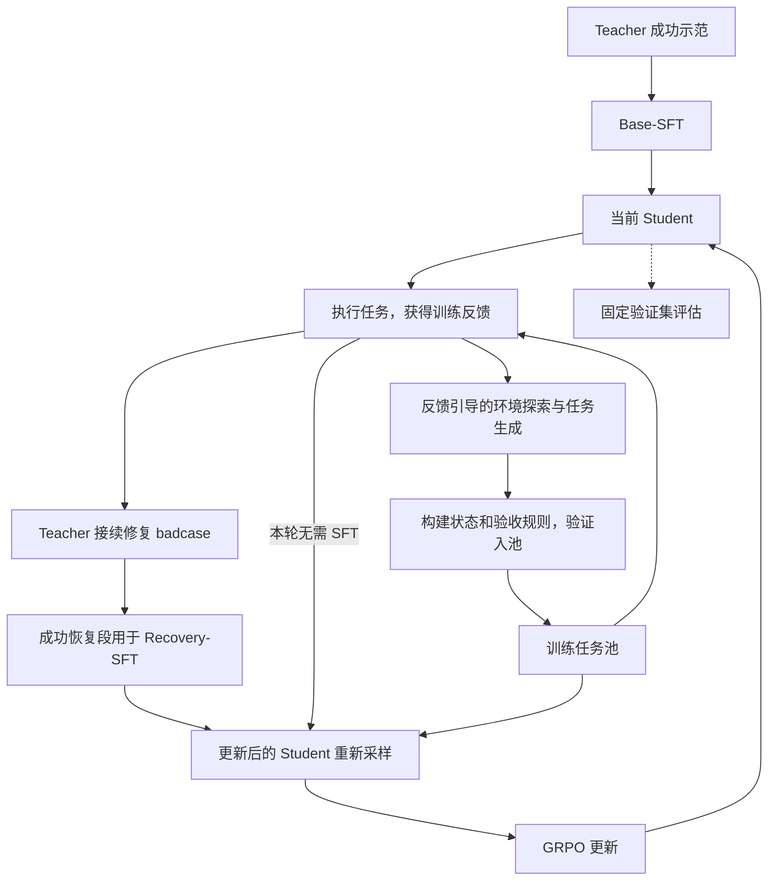

# RecoverAgent-RL v2：让任务与 Agent 一起进化

> 更新：2026-11-13。本文是当前唯一项目设计与实施计划。采用现有仓库和 AppWorld 底座，重新组织学习实验。
> 2026-11-14用户追加：原63次检查点恢复仅18条合格后缀，S1已真实更新。对余下45个train任务从干净初态补做：DeepSeek一次，未合格再用同服务GPT一次；保持64k与原单题预算，按完整示范单独导出，不冒充恢复后缀，不覆写当前S1及评估。原运行与新的补采分别保存配置、锁、全部尝试和成本。
> 当前S0→S1批次采用第5节的100题随机反馈方案：Teacher恢复覆盖全部符合条件的失败，不设60次总量限制；CoEvolve最多30个提案。单次恢复预算与每题一个起点保持不变；已于11月13日晚在L40S启动；实际进展与异常承接见STATUS。
> 2026-11-12：当前 v2 全链路统一为 65,536 token：Student 推理与阶段评估、Teacher 恢复、任务探索/生成/验证、Base-SFT、Recovery-SFT 和 GRPO。入口默认读取 `configs/v2_learning_64k_20261112.json` 及独立源码锁。其他请求、输出、时间和采样数量预算不变；旧 32k 配置与结果仅用于历史复现。此次仅完成软件接线，64k 显存仍需真实烟测。
> 2026-11-11 用户追加执行：先把 Teacher 采集与后续示范编码窗口提高到 65,536 token，累计收集 256 条合格成功示范，已有 train 来源成功计入；最多遍历现有 510 个 train 任务，每题本轮一次。使用当前 OpenCode Go 服务，不启动 Student 推理或训练。原 32k 实验和 dev/test 划分不改写；64k Student 训练另需实际显存验证。
> 最新执行要求（2026-11-09）：本轮保留 S0/S1/S2 学习闭环，在 S1 训练同时补齐 CoEvolve 的 AppWorld 方法，用该方法生成的新任务参与本轮 S2。方法范围、来源和适配差异见 [CoEvolve 接入说明](docs/COEVOLVE_APPWORLD_METHOD.md)。执行事实见 [STATUS](docs/STATUS.md)。

## 1. 项目要回答的问题

**在有限训练预算下，能否根据 Agent 当前的执行表现，持续生成合适的新任务，并结合失败恢复示范与在线强化学习，提高复杂工具任务的完整完成率？**

项目围绕一个 Student 展开。Student 在 AppWorld 中做任务，训练反馈同时驱动两条数据生产路径：一条让 Teacher 示范如何修复真实失败，一条生成针对能力缺口的新任务。随后通过短轮 Recovery-SFT 和当前策略 GRPO 更新同一个 Student，进入下一轮。

最终体现三个相互衔接的工作：

| 工作 | 要实现的能力 | 用什么证据说明价值 |
| --- | --- | --- |
| CoEvolve 式任务演化 | 从执行反馈出发，探索、生成并验证新任务 | 与固定任务池比较，以及新任务有效率、难度和能力覆盖变化 |
| badcase 回流 | 从真实失败状态获得 Teacher 成功修复示范，进行迭代 Recovery-SFT | SFT 前后完整任务表现、恢复表现及错误类型变化 |
| GRPO 自迭代 | Student 自己尝试任务，根据执行奖励更新策略 | 真实在线更新、奖励有差异的组占比、GRPO 前后及跨轮表现 |

CoEvolve 本身包含 GRPO；本项目借鉴其反馈驱动任务演化机制，结合 ReTerm 的恢复训练思路。项目贡献是把它们组织成可运行、可衡量的 AppWorld 学习系统，并验证组合的效果。论文来源见第 10 节。

## 2. 一次启动，随后循环学习

Base-SFT 用于建立初始执行能力；Recovery-SFT 可以在后续每轮按需发生。任务生成和 Teacher 修复可以分别处理同一批反馈；两个参数更新阶段按顺序执行。SFT 更新后，GRPO 使用更新后的 Student 重新采样。下一轮继承上一轮权重，不重置到初始模型。

第一版先完成两轮完整循环。每轮都要产出新的模型检查点、可用的数据和固定验证结果；“采集完成”“脚本通过”分别记录，不替代学习效果。

## 3. 首版技术选择

以下是首轮默认值，实施时写入一份运行配置。先用训练侧的小批量真实执行完成兼容性确认，再固定主实验配置；不开展多模型、大范围参数搜索。

| 项目 | 默认选择 |
| --- | --- |
| 环境 | 只使用 AppWorld，复用现有执行、评分和状态恢复代码 |
| Student | 首选 `Qwen/Qwen3.5-9B`；若现有训练栈在一个工作日内无法接通，整条新主线改用 `Qwen/Qwen3-8B`。只运行一个主模型 |
| Teacher / 探索模型 | 使用同一现成强模型服务承担两种角色，固定其参数和服务配置 |
| Agent 接口 | 文本 Function Calling、动态工具发现；Teacher / Student 共用任务执行规则，分别使用对应模型的原生聊天模板 |
| 推理方式 | 首版 non-thinking；模型版本、模板、工具协议在比较中一致 |
| 参数训练 | BF16 + LoRA；复用已有 SFT 部件和成熟 GRPO Trainer，优先 TRL 的多轮工具 / 自定义 rollout 接口 |
| 资源 | 按单张 80/96 GB GPU 规划，训练与采样分时运行，环境低并发；实际长序列显存以选定模型实测为准 |
| 奖励 | 完整任务成功为 1，否则为 0；环境故障单列 |
| GRPO 组 | 每任务 4 条当前策略轨迹，组内共享任务、起点与执行预算 |
| 恢复起点 | 每条选中失败默认一个已发生错误后的合法状态，优先可继续的末端状态；不以多检查点为首版目标 |

执行协议从现有 `execution_v6` 和 nullable schema 修复继续，优先保证模型输入、训练编码和实际执行一致。若真实训练侧案例表明需要修改提示或工具接口，单独保存新版本，并让所有比较使用同一版本。

每条 episode 默认最多 80 次模型请求、16,384 个累计生成 token、单回复 4,096 token、输入加回复不超过 65,536 token；工具调用不另设数量配额。基础执行超时先用 1,200 秒。正式评价关闭训练快照写入，分别记录模型、环境和额外训练数据处理的耗时。SFT 与 GRPO 的完整输入加目标使用同一窗口；Teacher 公共历史和工具按固定 Student tokenizer/non-thinking 模板计数，provider 原生用量另记。超限整条暂缓或停止，不截断历史、工具或 Assistant 目标。

9B 需要自己的模型加载、LoRA 目标模块和 tokenizer 适配，不能直接加载旧 4B adapter。单卡先降低并发、用梯度累积和已有节省显存的 loss 实现；只有实际性能阻塞学习运行时，再优化训练框架。

## 4. 数据与三个学习环节

### 4.1 一个共享训练池，一套固定评估

继续采用用户确认的 Full732 自定义研究协议。新实验按 `scenario_id` 分组，同一场景的三个变体进入同一划分：

| 划分 | 场景数 | 原始任务数 | 用途 |
| --- | ---: | ---: | --- |
| train | 170 | 510 | Base-SFT、失败采集、任务生成和 GRPO 共用 |
| dev | 37 | 111 | 固定开发评价和模型选择 |
| test | 37 | 111 | 方法确定后的最终评价 |

使用 seed `20261109` 对场景做确定性分组，不按模型结果选题。实现时保存任务清单和原始官方 split 元数据；报告称“Full732 场景隔离自定义划分”，不与官方排行榜成绩混用。

新任务和恢复示范继承训练来源；生成器不读取 dev/test 的题目、轨迹或失败案例。dev 中预先固定 8 个场景的 24 道题作为快速评价子集，正式比较使用完整 111 道 dev；它们属于同一个 dev 划分。

新主线从所选基础模型重新建立 Base-SFT 起点。已有 Teacher 原始消息可以按新 train 场景筛选、重新分词后复用；旧 4B 权重和旧 A/B/C 成绩只作历史参考。这样无需把此前的数据采集全部重做。

Full732 场景已在旧项目中有过采集或评价接触；这里的 test 表示与 v2 参数训练隔离的最终评价集，不声称是整个项目从未接触的隐藏测试。旧评价的逐题结果不进入 v2 任务生成、示范筛选或模型选择。

### 4.2 Base-SFT：得到共同起点

首轮目标约 96 条成功示范，覆盖训练池中不同任务类型和执行长度。优先使用符合新划分与协议的现有数据，不足部分再采集，避免只收最短、最容易的任务。

默认一个 epoch、LoRA rank 16、学习率 `5e-5`，micro-batch 1 并做梯度累积。只监督 Teacher assistant 的实际回复与工具调用；工具返回、用户与系统消息作为上下文。保存并重载共同起点 `S0`，后续比较均由它初始化。

超长样本单独统计，先使用可以完整训练的样本；若高价值长轨迹大面积被排除，再针对性解决上下文问题，不用静默截断目标来凑数据。

### 4.3 badcase 回流：迭代 Recovery-SFT

从当前 Student 的训练执行中选择有代表性的真实失败；优先处理遗漏操作、错误完成声明、工具使用和多步依赖错误。网络或环境故障不作为策略失败示范。

Teacher 从选中的真实状态、同刻可见历史和工具集合继续执行。它修复的仍是原任务，先前已经产生的副作用保留。原任务验收成功后，恢复后缀进入 SFT 数据池。

恢复尝试资格与训练数据资格分别判定：前者要求train来源的真实策略失败、有完整调用边界上保存且可一致恢复的状态/历史/工具，并且允许继续执行；环境故障不作为恢复学习样本。事前不要求保证Teacher能成功，也不能利用隐藏答案预测成功后才选题。后者还要求Teacher接续后通过原任务官方验收、来源和监督边界正确、完整编码符合上下文上限；失败、异常和超长记录保留但不作为合格成功后缀训练。

只监督 Teacher 新生成的 assistant token；Student 旧失败前缀和工具返回不计算 loss。默认以监督 token 为单位混合约 50% 恢复示范、50% 原有成功示范，做一轮学习率 `2e-5` 的短更新；数据不足时按实际量运行并报告覆盖，不以重复回合冒充独立任务。

这里的正常示范复用已有256条合格train成功数据，不要求Teacher为每个失败任务从头再做一次。按监督token选择或加权完整示范，使正常与恢复部分贡献接近，不能按任务条数假定50∶50，也不截断Assistant目标来凑比例。失败检查点是AppWorld环境状态，S0 checkpoint是Student模型权重；Teacher接续前者，S1训练加载后者的可训练adapter，使用两类数据继续参数更新。

恢复训练必须加载当前 Student 的可训练 adapter 继续更新。已有 `full732_sft_runtime.py` 会从 raw 模型新建 LoRA，不能直接把它当作增量 Recovery-SFT 入口；首个实现包需补这个薄接入层。

### 4.4 CoEvolve 式任务演化：决定下一轮练什么

本轮按最新用户要求采用一个通用的 CoEvolve AppWorld 生成流程：从真实探索抽象可执行目标，允许公开API支持的跨应用组合，不再限定固定Gmail题型。反馈信号、初始非引导探索、独立验收与训练中动态入池的具体范围见 [方法接入说明](docs/COEVOLVE_APPWORLD_METHOD.md)。

生成流程：

1. 汇总当前策略的任务族表现、组内成功比例、失败标签和动作覆盖。已有历史时再利用遗忘信号；同策略有多次尝试时才判断能力边界。
2. 强模型结合这些反馈与公开交互历史，进入训练环境实际探索，提出新目标、约束和任务参数。
3. 由受支持的任务生成器构建初始状态、用户指令、可执行验证解法和与新目标对应的程序验收器。
4. 验证解法确实成功，同时确认不执行或漏做关键操作不能通过；通过后进入训练池。

一个新任务至少保存 `task_id`、训练来源、任务族、公开指令、初态引用、验收器版本和验证结果。原始探索记录随 run 保存。改变目标、对象、约束或环境状态才算新的训练问题；仅改写题面不计新增任务。

采用简单的难度安排即可：多次全失败的能力补充示范或较容易的过渡任务；有成功有失败的任务优先用于 GRPO；已经熟练的任务降低采样频率。四次采样的判断只是启发式。无需独立诊断模型、学习式调度器或任意环境生成平台。

### 4.5 GRPO：根据 Student 自己的执行结果学习

默认从原始训练任务和已验证的新任务混合采样；新任务充足后先采用约 3:1 的原始 / 新任务组比例。一次更新可以对多个任务分别形成组，但不同任务的轨迹不混在同一个奖励比较组中。

Student 从同一任务初态独立执行 4 次，使用实际完整任务奖励进行 GRPO。监督位置只包含模型实际生成的 assistant token；工具结果和其他上下文不参与 policy loss。保留生成时的策略版本和 logprob，SFT 后重新采样并同步推理权重。

首版学习率 `1e-6`，每次更新 2 个任务组，累计 4 条轨迹 / 组；GPU 按单轨迹微批次和累积执行。全成功或全失败组缺少相对任务奖励信号，统计其比例；按配置处理，不为凑有效组无限采样。持续全失败时回到示范或任务难度，而不是盲目增加 RL 步数。

首版 GRPO 从完整任务起点训练，先验证完整任务能力。失败状态上的恢复 GRPO、多检查点和额外过程奖励作为后续选项，不同时加入首轮。

## 5. 首轮规模与推进方式

用下列规模完成第一份可解释的学习结果；这些是试点上限，不代表足以保证显著提升。

| 项目 | 初始默认 |
| --- | --- |
| Base-SFT | 约 96 条成功示范，1 epoch；补采最多 160 次尝试，已有合格示范计入目标 |
| 每轮反馈采样 | 20 个训练任务，各一次；正常 GRPO 轨迹也用于后续反馈 |
| 每轮 Teacher 恢复 | 最多 20 次，选不同失败任务，默认每任务一个起点 |
| 每轮任务生成 | 最多 10 个提案及其验证；实际通过多少就接纳多少 |
| 每轮 GRPO | 最多 16 个任务组、每组 4 条轨迹，约 8 个更新 batch |
| 第一份闭环结果 | 连续两轮，保存 SFT 与 GRPO 各自前后的 checkpoint |
| 资源边界 | 每轮 Student 训练侧总生成不超过 20 万 token，GPU 作业先按 8 小时上限规划；验证与 Teacher 开销另列并纳入运行总预算 |

真正运行前把已可用机器、Teacher 服务和实际费用上限写入运行配置。范围内连续推进，不把每一步改成等待审批的小阶段；文档更新本身不启动付费采集或 GPU 作业。

### 本次S0→S1批次（2026-11-13用户调整）

以下覆盖上表的本批次采样、恢复和生成数量，旧运行配置及锁保留原样；新批次另存独立配置、源码锁、名单和总资源预算，不直接复用旧15/20/10数量配置。

| 项目 | 本批次方案 |
| --- | --- |
| Student反馈 | 从未进入本次256条Base-SFT示范的254个train任务中，固定随机种子、无放回抽100题；不排除示范涉及的场景，不按结果换题，每题从干净初态执行一次 |
| Teacher恢复 | 所有有效自然失败、有合法可恢复检查点的任务均可进入；取消60次总量限制，每任务选一个起点、接续尝试一次，因此该100题批次最多100次恢复，实际按资格统计 |
| 合格恢复示范 | 25–40条是规划期望，不是保证、截断上限或提前停止条件；完整保留所有尝试，官方成功且满足完整64k编码规则的后缀全部纳入 |
| CoEvolve | 最多30个新任务提案及其验证；实际合格0–30个，分别记录提出、验证通过和S2实际使用数；新配置同步设置生成入口与CoEvolve内部提案上限 |
| 后续顺序 | 保存S0失败检查点后，Teacher恢复与CoEvolve可在隔离分支并行；从S0继续Recovery-SFT得到S1，再同条件评dev24；合格新任务留给S2，由S1重新采样 |

恢复分支只从Student真实失败状态、同刻历史和可见工具继续，不先让Teacher从头重做原题。以原任务初态为评分参照不等于重置执行状态。混入S1的正常成功示范复用已有train数据；CoEvolve新任务的独立成功解验证从该新任务定义的初态开始，与原任务检查点恢复分别计数和隔离。取消恢复总量60次限制不改变单次请求/token/时间预算，也不意味着反复重试同一失败。新任务入池不自动保证全部进入原16组GRPO，S2按实际合格量单独记录调度及使用数量。

一轮中没有合格恢复数据时可以跳过该轮 SFT；没有合格新任务时保留现有池继续训练并报告生成问题。若两轮后的主要限制仍是全零奖励、不可训练数据或执行吞吐，只修复该项实际瓶颈，再做一次有明确变化的学习实验。

## 6. 怎样判断项目有效

### 主指标与必要过程指标

主指标是**统一执行预算下，从原始初态独立执行的完整任务成功率**。辅助记录假完成率、平均请求 / token / 耗时、Teacher 修复成功及可训练转化率、新任务有效率、GRPO 奖励有差异的组占比。若收集固定恢复评价池，所有模型使用相同起点，恢复指标作为辅助。

每次评价同时列出成功、任务失败、基础设施异常和总任务数。异常单独处理并披露，最终比较尽量完成同一任务清单；阶段内的小样本变化作为方向性证据。

### 最小主实验

| 设置 | 用途 |
| --- | --- |
| `S0`：共同 Base-SFT 起点 | 参照初始执行能力 |
| `Static`：固定任务池 + 迭代 Recovery-SFT + GRPO | 检查恢复学习与强化学习能否推进能力 |
| `Evolve`：反馈生成任务池 + 迭代 Recovery-SFT + GRPO | 检查任务演化的增量价值 |

`Static` 和 `Evolve` 从同一 `S0` 开始，使用相同执行协议、轮数，以及 SFT 监督 token、Student rollout token 和 Teacher 总预算上限；Static 可把相应 Teacher 预算用于原任务示范，Evolve 将其中一部分用于任务探索与生成。报告实际消耗和随成本变化的结果，不仅对齐更新步数。

先用一个固定种子完成这张主表。结果有改善迹象后，只补与最终表述有关的比较：

- 要证明反馈选择优于一般数据扩充，加一组**等量、同任务族、同生成预算的非反馈任务生成**。
- 要分别归因 Recovery-SFT 或 GRPO 的独立作用，加对应的去除比较。保存阶段前后模型可展示学习过程，但不代替独立消融。

关键对照再补一个训练种子，冻结方法后对主表各组评测同一完整 test。保留逐任务配对结果；小样本波动和成本差异在结论中说明。首版无需一次铺开所有消融或预设成功率承诺。

## 7. 工程实施：保留底座，补齐学习链路

| 现有资产 | v2 用法 |
| --- | --- |
| `adapter.py`、`evaluation.py`、Student 执行器 | 复用工具执行、真实状态和任务评分 |
| `state.py`、`schema_snapshot.py`、nullable schema 修复 | 复用合法失败状态恢复；只在选中边界保存必要快照 |
| `recovery_suffix.py`、Teacher 采集与示范过滤 | 复用接续修复和恢复后缀导出 |
| `base_sft.py`、`sft_recipe.py` 与训练部件 | 复用 assistant-only 编码与 loss，增加模型配置和可继续训练入口 |
| 旧 Teacher 数据、4B M1 和 B10 归档 | 数据按新划分复用；权重与旧实验保留为历史 |

新增代码集中在三个地方：**受支持任务族的生成器、数据与当前 checkpoint 的训练适配、短轮训练编排**。一份配置描述一次运行，使用普通文件保存任务池、示范和报告；不新增服务平台或分布式调度系统。

保留影响实验正确性的基本约束：Actor 使用公开信息与工具；验收在控制侧；恢复状态与历史属于同一时刻；SFT / GRPO 使用正确的监督边界；评估数据不回流；每轮保存可重载权重和真实运行结果。测试只围绕改动可能破坏的这些事实。

暂缓多检查点价值学习、记忆系统、完整 CodeAct 迁移、额外奖励模型和多机训练。若计算或长上下文成为具体瓶颈，再增加必要工具或优化；不要先全面重构现有 Harness。

## 8. 给 Codex 的实施顺序

### 交付 1：一轮真实学习结果

在当前仓库补齐选定模型、共享数据入口、一个可验证任务生成器和多轮 GRPO 适配。按第 5 节的小规模完成 `S0 → 新失败与新任务 → Recovery-SFT → 新采样 GRPO → 新 checkpoint → 固定 dev 快评`。

优先修复现有 SFT 入口无法从当前 adapter 继续训练、数据入口写死旧 A 阶段的问题。新模型与任务接口接入后，直接把必要的短检查包含在实际运行中，不重新发起 M0/M1 诊断系列或全池数据审计。

交付内容只有：可执行入口及配置、真实任务与示范、可重载模型、dev 逐任务结果和成本摘要。若当前缺少可用算力或服务配置，先完成代码与配置，并明确列出启动所缺条件；不把未运行写成闭环完成。

### 交付 2：两轮循环和静态主对照

交付 1 可以先用一个任务生成器完成试点。正式 `Static / Evolve` 两轮比较开始前，固定支持的任务族和生成器版本；第二类生成器在比较开始前接入，或留待后续扩展。两轮之间只更新模型、反馈与任务池，让第二轮使用第一轮模型产生的反馈。根据真实学习信号调整后续实验规模，每次只解决最主要的一个瓶颈。

### 交付 3：结果与展示

对有效方案扩大训练并完成完整 dev/test、必要对照和第二个种子。最终交付一张主结果表、一张轮次 / 成本曲线，以及少量“失败—恢复—新任务—独立成功”的真实案例。简历填写已测结果及范围。

## 9. 当前起点与历史材料

已有真实 AppWorld 执行、状态恢复、Teacher 成功数据和 4B Base-SFT。B10 已产出 3 条合格恢复轨迹、23 个 assistant 回合和 5,066 个监督 token，证明恢复数据生产已接通；尚未执行 Recovery-SFT 或 GRPO。这些数据量不能当作已完成学习的证据。

- [B10 实际结果](reports/b10_teacher_recovery_execution_20261104.md)
- [已有 Teacher 数据](reports/full732_teacher_dataset_complete_20261029.md)
- [旧 M1 与 C244 结果](reports/full732_c244_final_20261031.md)
- [旧计划固定版本](https://github.com/WYXeva/RecoverAgent-RL/blob/cc711d61dee77fa7b5db1d852e8463e12bdbea7d/PROJECT_PLAN.md)

旧配置、报告、数据与权重保留。旧 A244/B244/C244、唯一 4B、多检查点主算法及逐阶段停等要求属于历史方案；v2 按本文和当前用户指示执行。实现新配置时不重签旧锁或覆写旧结果。

## 10. 方法与实现参考

- [CoEvolve 原论文](https://arxiv.org/html/2604.15840v1)：GRPO 与反馈驱动的环境探索、任务演化。
- [ReTerm 原论文](https://arxiv.org/html/2610.18484v2)：真实失败状态上的恢复示范和恢复训练。
- [AppWorld 任务生成指南](https://github.com/StonyBrookNLP/appworld/blob/main/guides/developing_new_task_generators.md)：任务初态、验证解法与程序验收。
- [TRL GRPO Trainer](https://huggingface.co/docs/trl/grpo_trainer)：在线组采样、策略更新和工具环境接入。
- [Qwen3.5-9B](https://huggingface.co/Qwen/Qwen3.5-9B)、[Qwen3-8B](https://huggingface.co/Qwen/Qwen3-8B)：模型及模板的官方说明。
