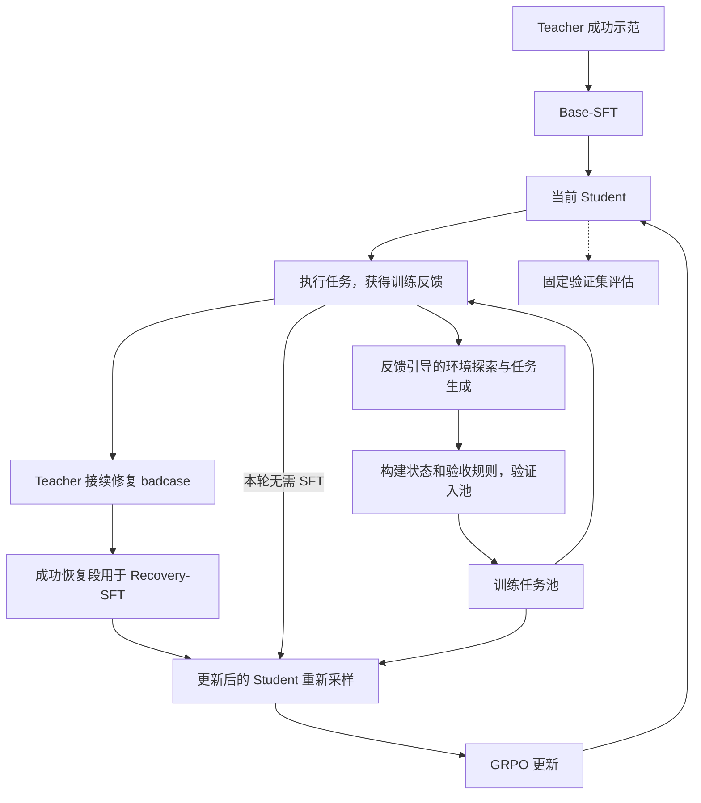

# RecoverAgent-RL v2：让任务与 Agent 一起进化

更新：2026-11-16。本文是唯一当前设计与实施计划，事实见 [STATUS](docs/STATUS.md)。

当前实验为 **S2 Static / Evolve 五轮 GRPO 对照**：两条分支各自从同一验收 S0 开始，复用固定 train100 和已有9条合格生成任务；Recovery-SFT 保留为前阶段结果，本阶段不再执行。模型固定 Qwen3.5-9B、64k、LoRA 和共享公开数字格式，采样与评价使用 vLLM。入口与资源条件见 [S2运行说明](docs/S2_STATIC_EVOLVE.md)。

S2并发执行版每组最多2条轨迹同时采样，仍收齐同策略的4条、每两组组织一次更新；Static/Evolve一致，dev/test仍串行。独立执行版本与源码锁不改变冻结实验配置和既有进度。当前24小时仅是本批资源上限，初期实测不足以保证完整两分支与最终评价在此时限内完成。

2026-11-16晚按用户最新指示优先执行Evolve。Static暂停在20组、6次已验收更新，保留后续续跑；Evolve独立从共同S0开始，每8组处理本窗口反馈并生成任务。暂停训练加速实验，正式运行继续使用已验收环境和双并发执行版，原任务规模与截止时间不变。

首批真实生成因Teacher入口接线及摘要索引问题产生0候选后，用户明确要求重新生成。使用独立执行版 `v2_s2_generation_20261116` 和新尝试目录重做原首批上下文；成功题进入后续尚未执行的槽，原失败记录保留。按用户指示取消累计金额拦截，继续保留调用数量/token/时间上限和当前实例绝对截止；不改变GRPO配置、Student任务数量或评分。

11月17日按用户指示将Teacher任务生成移到CPU/API后台，Student继续在现有池采样和更新；每8组只冻结并入队该窗口的四轨迹反馈，合格任务在后续任务组边界导入。Student独占学习state，Teacher只写验收产物；新题可能晚于来源轮次入池，报告实际延迟和参与训练情况。原始与生成槽比例、组内同策略/初态、预算和验收不变。独立执行版 `v2_s2_background_20261117`；用户允许OOM跳过，推理OOM记unknown，训练OOM跳过对应更新批次并保留更新前actor/optimizer。监督器独立于SSH运行，原绝对截止不变。

用户进一步调整生成准入：允许更简单的变体和组件子任务，不要求保留原任务的所有操作；取消反馈贴合的硬性审查。反馈继续作为出题参考，但不把Teacher对能力缺口的判断作为唯一入池门槛。保留真实探索证据、新颖性（实际简化可算变化，纯改写不算）、独立Solver和程序验收。新 `v2_s2_admission_20261117` 将多值答案字段/类型公开给Teacher与Student，由同一比较器验收；按新规则独立重做一次首批生成，旧2条成功和6条拒绝记录保留。这是运行中按用户指示改变准入策略，报告区分前后版本，不声称整轮始终使用原硬门槛。

前阶段40步短S1与S0的23个有效同硬件配对均为8/23，净增量0，因此共同起点仍为S0。历史采集与训练方案见各自报告和Git历史，不作为本次规模限制。本次S2软件实现与真实运行结果分别记录；实现通过不代表9B已更新或任务表现提高。

## 1. 项目要回答的问题

**在有限训练预算下，能否根据 Agent 当前的执行表现，持续生成合适的新任务，并结合失败恢复示范与在线强化学习，提高复杂工具任务的完整完成率？**

项目围绕一个 Student 展开。Student 在 AppWorld 中做任务，训练反馈同时驱动两条数据生产路径：一条让 Teacher 示范如何修复真实失败，一条生成针对能力缺口的新任务。随后通过短轮 Recovery-SFT 和当前策略 GRPO 更新同一个 Student，进入下一轮。

最终体现三个相互衔接的工作：

| 工作 | 要实现的能力 | 用什么证据说明价值 |
| --- | --- | --- |
| CoEvolve 式任务演化 | 从执行反馈出发，探索、生成并验证新任务 | 与固定任务池比较，以及新任务有效率、难度和能力覆盖变化 |
| badcase 回流 | 从真实失败状态获得 Teacher 成功修复示范，进行迭代 Recovery-SFT | SFT 前后完整任务表现、恢复表现及错误类型变化 |
| GRPO 自迭代 | Student 自己尝试任务，根据执行奖励更新策略 | 真实在线更新、奖励有差异的组占比、GRPO 前后及跨轮表现 |

CoEvolve 本身包含 GRPO；本项目借鉴其反馈驱动任务演化机制，结合 ReTerm 的恢复训练思路。项目贡献是把它们组织成可运行、可衡量的 AppWorld 学习系统，并验证组合的效果。论文来源见第 10 节。

## 2. 一次启动，随后循环学习

Base-SFT 用于建立初始执行能力；Recovery-SFT 可以在后续每轮按需发生。任务生成和 Teacher 修复可以分别处理同一批反馈；两个参数更新阶段按顺序执行。SFT 更新后，GRPO 使用更新后的 Student 重新采样。下一轮继承上一轮权重，不重置到初始模型。

当前按第5节完成两分支各五轮GRPO；每轮继承本分支最新actor和optimizer，KL reference始终固定共同S0。全零有效更新时保留上一actor，任务池与反馈仍结转。Recovery-SFT暂不加入这组对照。

## 3. 首版技术选择

以下约定已进入独立S2配置；复用已有训练与推理栈，不开展多模型或参数搜索。首次真实更新完成有限梯度、参数变化和保存重载检查后，下一批采样才切换actor。

| 项目 | 默认选择 |
| --- | --- |
| 环境 | 只使用 AppWorld，复用现有执行、评分和状态恢复代码 |
| Student | 固定已验收 `Qwen/Qwen3.5-9B` S0；本次不切换模型 |
| Teacher / 探索模型 | 使用同一现成强模型服务承担两种角色，固定其参数和服务配置 |
| Agent 接口 | 文本 Function Calling、动态工具发现；Teacher / Student 共用任务执行规则，分别使用对应模型的原生聊天模板 |
| 推理方式 | 首版 non-thinking；模型版本、模板、工具协议在比较中一致 |
| 参数训练 | BF16 + LoRA；复用已有 SFT 部件和成熟 GRPO Trainer，优先 TRL 的多轮工具 / 自定义 rollout 接口 |
| 资源 | 沿用已有单卡实例与已授权截止时间，训练与vLLM采样分时运行；本次完整64k GRPO显存仍需真实验证 |
| 奖励 | 完整任务成功为 1，否则为 0；环境故障单列 |
| GRPO 组 | 每任务 4 条当前策略轨迹，组内共享任务、起点与执行预算 |
| 恢复起点 | 每条选中失败默认一个已发生错误后的合法状态，优先可继续的末端状态；不以多检查点为首版目标 |

执行协议从现有 `execution_v6` 和 nullable schema 修复继续，优先保证模型输入、训练编码和实际执行一致。若真实训练侧案例表明需要修改提示或工具接口，单独保存新版本，并让所有比较使用同一版本。

每条 episode 默认最多 80 次模型请求、16,384 个累计生成 token、单回复 4,096 token、输入加回复不超过 65,536 token；工具调用不另设数量配额。基础执行超时先用 1,200 秒。正式评价关闭训练快照写入，分别记录模型、环境和额外训练数据处理的耗时。SFT 与 GRPO 的完整输入加目标使用同一窗口；Teacher 公共历史和工具按固定 Student tokenizer/non-thinking 模板计数，provider 原生用量另记。超限整条暂缓或停止，不截断历史、工具或 Assistant 目标。

9B 需要自己的模型加载、LoRA 目标模块和 tokenizer 适配，不能直接加载旧 4B adapter。单卡先降低并发、用梯度累积和已有节省显存的 loss 实现；只有实际性能阻塞学习运行时，再优化训练框架。

## 4. 数据与三个学习环节

### 4.1 一个共享训练池，一套固定评估

继续采用用户确认的 Full732 自定义研究协议。新实验按 `scenario_id` 分组，同一场景的三个变体进入同一划分：

| 划分 | 场景数 | 原始任务数 | 用途 |
| --- | ---: | ---: | --- |
| train | 170 | 510 | Base-SFT、失败采集、任务生成和 GRPO 共用 |
| dev | 37 | 111 | 固定开发评价和模型选择 |
| test | 37 | 111 | 方法确定后的最终评价 |

使用 seed `20261109` 对场景做确定性分组，不按模型结果选题。实现时保存任务清单和原始官方 split 元数据；报告称“Full732 场景隔离自定义划分”，不与官方排行榜成绩混用。

新任务和恢复示范继承训练来源；生成器不读取 dev/test 的题目、轨迹或失败案例。本次使用已固定8个场景的dev24进行各轮比较和checkpoint选择；S0与每分支最佳轮统一在已冻结test111上最终评价。不在本轮扩大dev。

已完成9B Base-SFT，本次直接验证并加载现有S0，不重新训练基座。旧4B权重和旧A/B/C成绩只作历史参考。

Full732 场景已在旧项目中有过采集或评价接触；这里的 test 表示与 v2 参数训练隔离的最终评价集，不声称是整个项目从未接触的隐藏测试。旧评价的逐题结果不进入 v2 任务生成、示范筛选或模型选择。

### 4.2 Base-SFT：得到共同起点

已验收S0使用256条train成功示范。原数据、模型revision及adapter哈希保持不变，本次S2不新增Base-SFT。以下保留Base-SFT方法约定。

默认一个 epoch、LoRA rank 16、学习率 `5e-5`，micro-batch 1 并做梯度累积。只监督 Teacher assistant 的实际回复与工具调用；工具返回、用户与系统消息作为上下文。保存并重载共同起点 `S0`，后续比较均由它初始化。

超长样本单独统计，先使用可以完整训练的样本；若高价值长轨迹大面积被排除，再针对性解决上下文问题，不用静默截断目标来凑数据。

### 4.3 badcase 回流：迭代 Recovery-SFT

本节保留Recovery-SFT方法；本次S2不运行此阶段。此前18条恢复后缀、21条新增完整示范及短更新结果保留。恢复数据来自有代表性的真实失败，网络或环境故障不作为策略失败示范。

Teacher 从选中的真实状态、同刻可见历史和工具集合继续执行。它修复的仍是原任务，先前已经产生的副作用保留。原任务验收成功后，恢复后缀进入 SFT 数据池。

恢复尝试资格与训练数据资格分别判定：前者要求train来源的真实策略失败、有完整调用边界上保存且可一致恢复的状态/历史/工具，并且允许继续执行；环境故障不作为恢复学习样本。事前不要求保证Teacher能成功，也不能利用隐藏答案预测成功后才选题。后者还要求Teacher接续后通过原任务官方验收、来源和监督边界正确、完整编码符合上下文上限；失败、异常和超长记录保留但不作为合格成功后缀训练。

只监督 Teacher 新生成的 assistant token；Student 旧失败前缀和工具返回不计算 loss。默认以监督 token 为单位混合约 50% 恢复示范、50% 原有成功示范，做一轮学习率 `2e-5` 的短更新；数据不足时按实际量运行并报告覆盖，不以重复回合冒充独立任务。

这里的正常示范复用已有256条合格train成功数据，不要求Teacher为每个失败任务从头再做一次。按监督token选择或加权完整示范，使正常与恢复部分贡献接近，不能按任务条数假定50∶50，也不截断Assistant目标来凑比例。失败检查点是AppWorld环境状态，S0 checkpoint是Student模型权重；Teacher接续前者，S1训练加载后者的可训练adapter，使用两类数据继续参数更新。

恢复训练已由 `v2_training.py` 支持从可训练adapter继续更新；S2复用已验收S0，不继承未改善的S1。

### 4.4 CoEvolve 式任务演化：决定下一轮练什么

本轮按最新用户要求采用一个通用的 CoEvolve AppWorld 生成流程：从真实探索抽象可执行目标，允许公开API支持的跨应用组合，不再限定固定Gmail题型。反馈信号、初始非引导探索、独立验收与训练中动态入池的具体范围见 [方法接入说明](docs/COEVOLVE_APPWORLD_METHOD.md)。

生成流程：

1. 汇总当前策略的任务族表现、组内成功比例、失败标签和动作覆盖。已有历史时再利用遗忘信号；同策略有多次尝试时才判断能力边界。
2. 强模型结合这些反馈与公开交互历史，进入训练环境实际探索，提出新目标、约束和任务参数。
3. 由受支持的任务生成器构建初始状态、用户指令、可执行验证解法和与新目标对应的程序验收器。
4. 验证解法确实成功，同时确认不执行或漏做关键操作不能通过；通过后进入训练池。

一个新任务至少保存 `task_id`、训练来源、任务族、公开指令、初态引用、验收器版本和验证结果。原始探索记录随 run 保存。改变目标、对象、约束或环境状态才算新的训练问题；仅改写题面不计新增任务。

采用简单的难度安排即可：多次全失败的能力补充示范或较容易的过渡任务；有成功有失败的任务优先用于 GRPO；已经熟练的任务降低采样频率。四次采样的判断只是启发式。无需独立诊断模型、学习式调度器或任意环境生成平台。

### 4.5 GRPO：根据 Student 自己的执行结果学习

本次每轮交替20个原始槽和20个生成优先槽；生成不足时原始题补位，生成最多50%。同题组内四条共享当前策略和干净初态，使用不同随机种子；不同任务不混成奖励组。具体跨轮规则见第5节。

Student 从同一任务初态独立执行 4 次，使用实际完整任务奖励进行 GRPO。监督位置只包含模型实际生成的 assistant token；工具结果和其他上下文不参与 policy loss。保留生成时的策略版本和 logprob，SFT 后重新采样并同步推理权重。

学习率 `1e-6`、KL系数 `0.001`；每两组组织一次更新，每组4条。仅完整可评分且奖励有差异的组进入更新，恒定奖励组跳过，不做KL-only更新。每次真实更新保存optimizer/RNG并重载核验；下一批采样加载新权重，KL reference仍为共同S0。整轮无更新也继续既定采样、反馈与评价。

首版 GRPO 从完整任务起点训练，先验证完整任务能力。失败状态上的恢复 GRPO、多检查点和额外过程奖励作为后续选项，不同时加入首轮。

## 5. 当前S2规模与推进方式

| 项目 | 每分支设置 |
| --- | --- |
| 模式与起点 | static / evolve，分别独立加载同一验收S0 |
| 初始池 | 固定train100 + 已有9条合格生成任务 |
| 训练 | 5轮 × 40组 × 4条 = 800个执行slot；两分支合计1600 |
| 更新 | 每2组一次机会，最多100次真实optimizer更新；LR1e-6，KL0.001 |
| 槽位 | 每轮原始/生成优先交替各20个，生成不足原始补位 |
| 生成 | 仅evolve，每8组处理刚完成窗口，最多4个context；每context两次独立探索、合并证据抽象最多2题 |
| 生成总量 | 最后第200组不生成；最多24批、96个context、192个新增候选，已有9条不计入 |
| 评价 | 复用20261115同协议S0 dev24（8成功/15失败/1未知）、每轮dev24；按成功率选分支最佳轮，同分选较早轮，再与S0统一test111 |
| 预算 | 每分支训练最多13,107,200生成token/64,000请求；评价597个slot中24个复用旧基线、573个待执行；Teacher独立有限预算见配置 |

原始题采用跨轮连续打乱队列，覆盖100题后才重新打乱。生成题优先从未训练过的新题，再从本轮未使用旧题中选择，同一生成题每轮最多一组；每轮仅重置“本轮使用”集合，历史反馈、任务池和原始队列保留。再次抽中时由当时Student从该题初态重新采样四次。Static通常每轮9个生成组、31个原始组，生成题可连续五轮复用。

反馈只从最近8个实际完成的组slot中选择；未知/异常另列。每组四条须同任务、同策略、同初态，重复任务保留最新完整组。优先级为boundary+forgetting、boundary、forgetting、其他all_failed、rare-only，同档按任务ID；先保证一个排序最前的all_failed，再补足最多4个不同任务。近期历史按同任务最近8个完整组保留，遗忘必须引用本组开始前的成功，组内先成功后失败不能当遗忘。

组级context使用四份公开交互及策略/结果，沿用六个context字段。完整输入可容纳时直接分析；只有实测超窗才逐条生成有消息索引和SHA关联的摘要。两次探索各自从来源环境干净初态启动，合并带rollout_id/action_index的证据，不合并状态。仅合并抽象输入实测超窗允许各探索最多1题的回退，仍合计最多2题。

复用新颖性、独立Solver、semantic judge及程序验收，另核查反馈贴合；全失败简化题须保留核心能力并减少无关复杂度。合格任务立即入池，拒绝与异常记录后继续训练。每候选保留来源任务/策略/四次轨迹/context/探索/目标/验收/后续采样更新的关联；dev/test不进入生成。

S0基线与当前同型号L40S但物理GPU不同，报告保留此限制；不为本阶段重跑已完成dev24，不将新旧结果逐题择优拼接。原中断项维持未知。

每8组和每轮写轻量JSON/Markdown结果及约5个实际案例；记录生成数、使用数、非零优势贡献、分类奖励、真实更新与成本。轮末报告后按配置继续。断点保存actor、optimizer、池、反馈、队列、随机状态与窗口进度；已派发中断slot标未知并保留成本，不重发挑结果。未提交参数更新可从已保存parent续做。

运行使用独立配置、源码锁和私有目录。GPU截止时间必须来自当前授权，不由续跑命令自动延长；旧配置/锁、权重与原始结果不覆写。完整命令与目前真实启动条件见 [运行说明](docs/S2_STATIC_EVOLVE.md)。

## 6. 怎样判断项目有效

### 主指标与必要过程指标

主指标是**统一执行预算下，从原始初态独立执行的完整任务成功率**。辅助记录假完成率、平均请求 / token / 耗时、Teacher 修复成功及可训练转化率、新任务有效率、GRPO 奖励有差异的组占比。若收集固定恢复评价池，所有模型使用相同起点，恢复指标作为辅助。

每次评价同时列出成功、任务失败、基础设施异常和总任务数。异常单独处理并披露，最终比较尽量完成同一任务清单；阶段内的小样本变化作为方向性证据。

### 最小主实验

| 设置 | 用途 |
| --- | --- |
| `S0`：共同 Base-SFT 起点 | 参照初始执行能力 |
| `Static`：固定train100+生成9任务池 + GRPO | 衡量固定池上的在线强化学习 |
| `Evolve`：相同初始池 + 持续CoEvolve + GRPO | 衡量反馈驱动任务演化的增量 |

两分支从同一S0独立开始，Student执行次数、采样规则、协议和单题预算相同。允许生成题实际占比和有效更新次数不同；Teacher仅用于Evolve的生成与验证，分别报告实际成本，不声称总算力/Teacher成本相等。训练始终继承本分支最新actor，dev仅决定最终所选checkpoint，不回滚中途训练。此次只保留这两条主分支，不加合并/分开抽象对照。

先用一个固定种子完成这张主表。结果有改善迹象后，只补与最终表述有关的比较：

- 要证明反馈选择优于一般数据扩充，加一组**等量、同任务族、同生成预算的非反馈任务生成**。
- 要分别归因 Recovery-SFT 或 GRPO 的独立作用，加对应的去除比较。保存阶段前后模型可展示学习过程，但不代替独立消融。

关键对照再补一个训练种子，冻结方法后对主表各组评测同一完整 test。保留逐任务配对结果；小样本波动和成本差异在结论中说明。首版无需一次铺开所有消融或预设成功率承诺。

## 7. 工程实施：保留底座，补齐学习链路

| 现有资产 | v2 用法 |
| --- | --- |
| `adapter.py`、`evaluation.py`、Student 执行器 | 复用工具执行、真实状态和任务评分 |
| `state.py`、`schema_snapshot.py`、nullable schema 修复 | 复用合法失败状态恢复；只在选中边界保存必要快照 |
| `recovery_suffix.py`、Teacher 采集与示范过滤 | 复用接续修复和恢复后缀导出 |
| `base_sft.py`、`sft_recipe.py` 与训练部件 | 复用 assistant-only 编码与 loss，增加模型配置和可继续训练入口 |
| 旧 Teacher 数据、4B M1 和 B10 归档 | 数据按新划分复用；权重与旧实验保留为历史 |

新增代码集中在三个地方：**受支持任务族的生成器、数据与当前 checkpoint 的训练适配、短轮训练编排**。一份配置描述一次运行，使用普通文件保存任务池、示范和报告；不新增服务平台或分布式调度系统。

保留影响实验正确性的基本约束：Actor 使用公开信息与工具；验收在控制侧；恢复状态与历史属于同一时刻；SFT / GRPO 使用正确的监督边界；评估数据不回流；每轮保存可重载权重和真实运行结果。测试只围绕改动可能破坏的这些事实。

暂缓多检查点价值学习、记忆系统、完整 CodeAct 迁移、额外奖励模型和多机训练。若计算或长上下文成为具体瓶颈，再增加必要工具或优化；不要先全面重构现有 Harness。

## 8. 给 Codex 的实施顺序

### 交付 1：已有学习结果

已有9B Base-SFT、真实失败恢复数据、生成任务及GRPO/SFT试点。最近短Recovery-SFT没有净改善，因此本次共同起点保留S0。结果与历史配置留档，不重复采集或重训前阶段。

### 交付 2：当前Static / Evolve五轮主对照

复用训练、探索、任务生成与验收代码，实现第5节调度、组级反馈、在线权重切换和断点续跑。先完成必要软件验证，按已授权可用资源执行；缺少资源时交付完整入口/配置/命令及具体启动条件，不能把软件模拟当真实闭环。只使用现有生成器，不增加第二任务家族或额外消融。

### 交付 3：结果与展示

输出五轮dev曲线、末轮和最佳成绩、逐题新增成功/退步、统一test111、实际更新/成本与约5个案例。真实结果不足或未改善也完整报告；第二种子、消融和新方法在本次结果后再安排。

## 9. 当前起点与历史材料

已有真实AppWorld执行、状态恢复、Teacher示范、9B Base-SFT及Recovery-SFT/GRPO试点。现有S0由256条完整成功示范训练，近期40步短S1同协议有效配对无净提升；本次S2沿用S0、train100和9条既有合格生成任务。当前五轮对照的代码验收与真实模型更新/效果分别记录。

- [近期短更新与vLLM配对结果](reports/v2_s1_short_paired_dev24_20261115.md)
- [S2实现验收](reports/s2_static_evolve_implementation_20261116.md)
- [B10 实际结果](reports/b10_teacher_recovery_execution_20261104.md)
- [已有 Teacher 数据](reports/full732_teacher_dataset_complete_20261029.md)
- [旧 M1 与 C244 结果](reports/full732_c244_final_20261031.md)
- [旧计划固定版本](https://github.com/WYXeva/RecoverAgent-RL/blob/cc711d61dee77fa7b5db1d852e8463e12bdbea7d/PROJECT_PLAN.md)

旧配置、报告、数据与权重保留。旧 A244/B244/C244、唯一 4B、多检查点主算法及逐阶段停等要求属于历史方案；v2 按本文和当前用户指示执行。实现新配置时不重签旧锁或覆写旧结果。

## 10. 方法与实现参考

- [CoEvolve 原论文](https://arxiv.org/html/2604.15840v1)：GRPO 与反馈驱动的环境探索、任务演化。
- [ReTerm 原论文](https://arxiv.org/html/2610.18484v2)：真实失败状态上的恢复示范和恢复训练。
- [AppWorld 任务生成指南](https://github.com/StonyBrookNLP/appworld/blob/main/guides/developing_new_task_generators.md)：任务初态、验证解法与程序验收。
- [TRL GRPO Trainer](https://huggingface.co/docs/trl/grpo_trainer)：在线组采样、策略更新和工具环境接入。
- [Qwen3.5-9B](https://huggingface.co/Qwen/Qwen3.5-9B)、[Qwen3-8B](https://huggingface.co/Qwen/Qwen3-8B)：模型及模板的官方说明。
