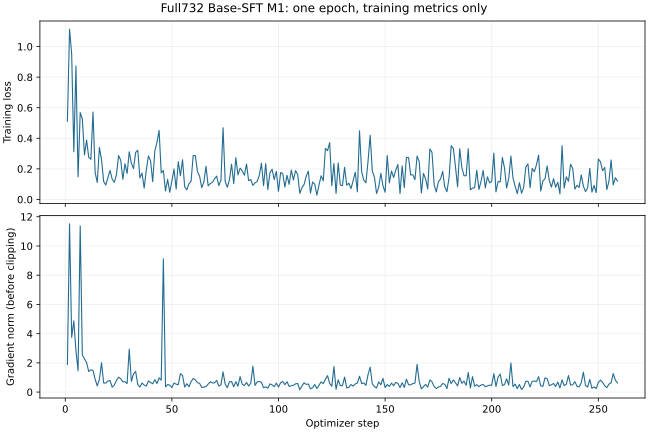

# Full732 Base-SFT M1：训练与重载PASS，C244评估进行中

最后更新：2026-10-30。网络已恢复，用户确认在当前实际A100-SXM4-80GB机器开始。远程数据复验、两次真实烟测及正式训练全部通过。全部2070样本完整训练1 epoch，实际259优化步；最终保存/重载验收PASS。固定C244已启动，尚未完成，不报告完整TGC。前次网络阻塞记录独立保存在 `reports/full732_m1_network_blocked_20261030.md/json`，不能作为当前状态。

## 源码、设备与数据

- 分支 `codex/p0-p2-recovery` 包含指定 `88836690c2ada2a14fc254a2f480ce2e44562773`。网络恢复后临时clone/fetch成功；训练实际源码 `a6cae3569bf715b1e7854a286b9e2415f0a61702`，归档SHA `1d0732b05ea6fb54bf8036ba9c370d14eada1b2f9381cc83360da13c72aaef1e`。
- `ssh.txt`当前连接实际为A100 80GB，区别于原定PRO6000 96GB。用户经说明后确认开始。新增独立A100适配和锁 `76a33ff0ac5c8b6e06062d44607f1cad99d9ab12bc6ecc19eff12901a9ebed6a`，保留原96GB配置、原Full732锁及历史P3-B源码/权重。未新租机器、未读取历史95条数据。
- 原始manifest `96265f67a5828b101f5db32a804008478d7c419a01e079f6e468b8e5f164735f`；归档SHA `64c2a5854f0a3a9cfab72f71e13682dce5e535ff0b885768b98dc0073d6a7a48`。远程全包校验、重新分词、Assistant-only mask和A/B/C隔离通过：138候选、2070样本、338413监督token、22444500屏蔽token、最长32693。原包不改动，无截断、无调用删除、无Assistant目标修改。
- 固定原始 `Qwen/Qwen3-4B` revision `1cfa9a7208912126459214e8b04321603b3df60c`，模板SHA `a55ee1b1660128b7098723e0abcd92caa0788061051c62d51cbe87d9cf1974d8`，non-thinking；原始模型10文件哈希、BF16和固定训练/AppWorld依赖通过。LoRA r16/alpha32/dropout0.05、7投影、学习率1e-4不变。

## 真实训练门槛

| 阶段 | 状态 | 完整样本 | optimizer steps | 峰值allocated GiB | 重载logits最大误差 |
|---|---|---:|---:|---:|---:|
| 短烟测 | PASS | 4 | 2 | 8.849 | 0.0 |
| 最长样本烟测 | PASS | 1 | 1 | 23.159 | 0.0 |
| 全量1 epoch | PASS | 2070 | 259 | 23.400 | 0.0 |

短烟测使用4完整短样本；长烟测使用32693 Token最长完整样本。两者梯度均有限且非零、LoRA参数真实变化，保存后重载参数hash完全相同，logits误差0。各次均从raw base重新初始化，正式M1不继承烟测参数。完整LoRA前后/重载哈希、配置、依赖、显存、耗时及文件SHA见 `reports/full732_m1_a100_smoke_evidence_20261030.json`。

正式训练为batch1/gradient accumulation8、1 epoch，真实dataloader为2070 batch，实际259优化步；逐样本消费记录与原2070样本完整一致。训练loss为0.17856314776889606，epoch=1.0，训练墙钟7730.1125秒；总阶段耗时7757.6100秒。所有259步梯度有限非零。每步保存loss和梯度检查，50/100/150/200/250步保存状态均留有观察证据；最终保留250/259 checkpoint及optimizer/scheduler/RNG。仅训练loss，无内部验证集、early stopping或C选checkpoint。私有完整日志和checkpoint位于远程独立 `recoveragent_full732_m1_20261030/runs/run_001/`。

## C244准备与边界

新增独立C244入口，复用原Student执行引擎，固定完整C244和原始split来源，execution_v6全文、动态发现、40请求/16384生成/4096单回复/32768上下文/600秒、seed42、temperature0.8、top_p0.95、Memory关闭。旧C30入口和历史源码锁不改；新源码锁绑定当前引擎，解决旧v6锁与后来adapter研究扩展不匹配的问题。后端仅接受经过正式训练及重载的全量M1，校验参数hash。

C244已在正式M1验收后启动，后端加载身份严格绑定最终LoRA哈希，首项真实AppWorld评估已完成。当前仍在执行固定244项清单，不能把局部进度视为完整验证成绩。它是自定义Full732已知场景开发评估，不是官方排行榜或未见场景泛化。未知保持null，不记失败0；完整244项均有效才给完整TGC。C不进入Trainer或checkpoint选择，不运行Recovery-SFT、GRPO或B侧采集。

软件验证：`PYTHONPATH=src:. .venv/bin/pytest -q` 为 **571 passed in 9.90s**；新增训练A100/C244文件Ruff通过。初次全套测试因命令仅设`PYTHONPATH=src`导致5个`scripts`导入错误，修正测试启动路径后完整通过，无源码修补掩盖失败。

待完成：正式训练完整归档回传与本地逐文件校验、固定C244评估及最终状态提交。远端已逐一复核正式checkpoint的50文件SHA；完整训练配置、259步loss/梯度及checkpoint观察证据见 [训练验收JSON](full732_m1_verified_training_20261030.json)。训练曲线如下（仅训练指标）：

两次烟测完整产物已回传并分别核验50/35个文件SHA；正式训练归档正在传输。

## 最终M1权重验收与数据复验

- 初始LoRA参数hash：`029b841888928835aab325ecfa0f304f271829422a58776f5a0daa6dcd1f9f49`。
- 训练后及重载hash均为：`3b9cf8f3aed4b36b9d55d0289d3a2f99faef400af80480f7179d09fcf3aa400c`；logits最大绝对误差0.0。
- 最终GPU峰值allocated为25125226496 bytes（23.400 GiB），reserved为36438016000 bytes（33.936 GiB）；外部GPU采样记录另存CSV，不能将allocated和设备总占用混为一项。
- 正式checkpoint回执SHA：`e3ed1f2c343f71552cdb2965d36492ae5b81c3835eb9e544ce6be14dbbdcd895`。实际回执摘录见 `reports/full732_m1_formal_acceptance_20261030.json`；其中C244统计仅是当时的进度快照。
- 训练后再次执行只读原始包校验，原manifest仍为96265f67…，138/2070/338413及全部包内SHA通过；本次复验不重复分词、不调用模型。此前远程完整重分词已经通过。
- 正式训练归档（不重复打包已回传的两份烟测）：883090152 bytes，SHA256 `405c33479df36d31471f26376d2d5411ee12018b5fe34dae116482ba5cc4c0bf`。首次SCP因连接重置在77291520 bytes处中断；已核验远端/本地已下载前缀SHA相同，按字节续传。本地完整校验尚待完成，未影响远端训练或C244。
- 监控期间曾收到远端SSH `Exceeded MaxStartups`；使用持续的已认证连接恢复只读监控，训练持续推进，没有重启训练或补做任何优化步。
