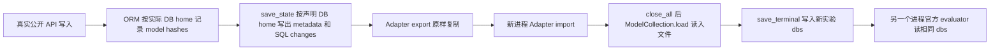

# Full732 Stage 2B：快照评分保真度

日期：2026-10-28。开发分支 `codex/p0-p2-recovery`，已 fetch、ff-only pull 并确认基线包含 `25e6dacd5ad5854afd5c7fc9beec8c49531faf84`。只执行 Stage 2B。

**结论：本次固定任务的新保存/跨进程恢复/评分链路 PASS；旧快照未修复，历史证据仍保留 5/5 与重评 4/5。Full732 及共享评分全局门槛继续 BLOCKED/PARTIAL。** 新旧终态的数据库行相同，12 个数据库变更文件也逐字节相同，13 个快照文件中唯一差异是 `model_hashes.json`。不能把行哈希相同当作评分等价。

## 范围和实际结果

固定写入控制任务只有官方 train `07b42fd_1`，事先登记于私有 `runs/full732_stage2b_20261028/execution_plan.json`。`76f2c72_1` 仅核验旧封存文件与 Stage 2 回执，未启动其环境、工具或评价。本轮没有读取 P3-C 检查点，没有扩大到其他任务或 test 内容。

| 对象/阶段 | 实际证据 | 判定 |
| --- | --- | --- |
| 旧 Teacher `teacher_935fa94ac30d` | 原报告 5/5；原 checkpoint、导出 DB、原终态的 model hashes 均 `{}` | 缺失在本次恢复之前；原结果不改 |
| 旧状态的 Stage 2 独立恢复 | 既有完整原 tracker 4/5；本轮只读复核 | 未复现成功，不重新执行或覆盖 |
| 同轨迹历史兼容环境重放 | 既有 17 次工具返回一致、非空 metadata、独立 5/5；本轮复验原 receipt/manifest/evaluation SHA 及终态文件 | 既有证据有效，不计本轮新执行 |
| 本轮唯一官方参考程序 | 未修改 `_verify_task`，15 次真实公开 API，live 官方 5/5 | PASS |
| 同一新终态 save/export | 内存、命名保存、导出 metadata 一致；行哈希及变更追踪摘要一致 | PASS |
| 新进程 Adapter import/save | 与 live 相同逻辑行、metadata、变更追踪；全部 13 文件相同 | PASS |
| 再一个新进程官方评价 | 5/5，原始 tracker 与 live 逐字节相同；评分前后保存文件不变 | PASS |
| 既有只读业务对照 `76f2c72_1` | metadata `{}`，Stage 2 独立官方 2/2 | 不得以“空文件”一律拒绝；这本身也不证明它的所有元数据完整 |

这是官方 train 参考程序/快照工程验证，不是 Teacher 新示范、Student 推理或模型成功率。源码没有复制参考解答；使用官方原生单任务函数，未调用遍历全池的 `verify_tasks`。参考代码、工具记录、数据库及原始 tracker 留在私有目录，不进入 Actor、训练集或公开报告。

## 根因和证据边界

固定上游 revision：`42b5bcf3cd334fee33f0c37c02070a9f5807add5`。已检查 `environment.py:1279/1335/1348`、`apps/lib/apis/local_remote.py:147`、`apps/lib/models/db.py:119/170`、`apps/lib/models/orm.py:860`、`collections/models.py:254/363/432`、`evaluator.py:469`。未改任何官方源码。

1. **旧采集已写出空 metadata。** 原实验 `checkpoints/p3a_terminal/model_hashes.json`、`dbs/model_hashes.json` 和封存 `terminal/dbs/model_hashes.json` 都是相同的两个字节 `{}`，文件 SHA `44136fa355b3678a1146ad16f7e8649e94fb4fc21fe77e8310c060f61caaff8a`。封存 manifest 与正式数据集来源链匹配。因此本次 `import_state` 不是第一次丢失它的边界，export 的复制也没有把非空源变空。
2. **依赖 URI 反解析错误已复现。** 旧依赖锁及仍保留的 `.venv` 为 SQLAlchemy 2.1.5；在不创建任务、不执行业务操作的官方 URI 探针中，请求 `:memory:stage2b_uri_probe`，实际解析为 `:memory:file%3Astage2b_uri_probe`。既有 `.venv-harness` 的 2.0.52 则解析完全一致。两环境 SQLModel 均 0.0.48；未安装或修改依赖。
3. **错误键能解释“live 有变化而保存为空”。** 官方 ORM 将计数累加到 `ModelHashHandler.data[SQLModel.db.home_path]`；`_save_state → save_local_dbs → ModelHashHandler.save` 却从声明的 `world.models_to_db_home_path` 取值。URI 渲染不兼容时两键不同，缺失键对应空 defaultdict，并原样写出。`load` 按文件内容加载，不会从行差异猜出遗漏的计数。官方 evaluator 有意复用同一个 task-output memory home；同进程的错误键计数可能仍在，而新进程只有空文件，这解释旧live与独立恢复不同（属于机制解释，非历史RAM实测）。`ModelCollectionPair._changed_model_names` 先比较 model hashes，再比较行/record hashes；两个计数都缺失时，候选模型可能在比较行之前已被排除。
4. **不是新发现一个尚未实施的依赖修复。** D030/D032 和 `reports/harness_v1_report.md` 已记录这一兼容问题及隔离环境修复。进一步精确核验同一个 `teacher_935fa94ac30d` 的历史重放：receipt、terminal manifest、独立 evaluation 的 SHA 均与已提交汇总相符，13 个 DB 文件匹配原 manifest，官方 5/5。此次不重复重放，也不把历史 17 次调用计入新增成本。
5. **证据限度。** 原采集时的完整 RAM registry 没有封存，无法补造“当时每次计数更新/保存调用”的逐事件日志。确认到的边界是**原采集保存产物已缺失**；具体错误键机制由固定源码、旧环境 URI 实测及同轨迹兼容环境重放共同支持。不能声称直接观察了历史 RAM，也不排除未检查的旧样本有其他问题。

项目 `adapter.py:120/151/157/173` 的 fingerprint 仅哈希逻辑行；export 调官方命名 `save_state` 后 copytree，import 校验副本、`load_state` 后恢复时钟，save_terminal 调官方 save。`teacher_history.capture_terminal:33` 和 `state.capture:11` 先 export，再封存历史/运行时和文件 SHA；`state.restore:120` 的行/运行时核验不能独自证明评分 metadata 等价。**文件 SHA 可以证明忠实复制，但无法证明源文件一开始就是完整状态。**

## 数据流与每个边界



旧链路中的实际/声明 home 失配机制在 B→C；已保存的旧 C/D 都为空。新链路 B→H 均实测，未在 load/close_all 后发现额外丢失。官方 evaluator 固定从 `experiments/outputs/<experiment>/tasks/07b42fd_1/dbs` 加载终态；本次该路径的 metadata 与导出一致，没有使用另一个格式或目录替代。

令 `R=runs/full732_stage2b_20261028`，`L=data/appworld/experiments/outputs/stage2b_live_2ae5faf216126df9e97a/tasks/07b42fd_1`，`I=data/appworld/experiments/outputs/stage2b_restore_cbc20a5389c63cba0bba/tasks/07b42fd_1`：

| 边界 | 实际路径/回执 | 核验内容 |
| --- | --- | --- |
| 首次自动保存调用之前 | `R/live_verified/save_boundary_01.json` | 官方程序业务调用结束后的内存摘要；尚未进入该次 `_save_state` 写出 |
| 显式保存前/后 | `R/live_verified/boundaries.json` | 逻辑行、metadata 键集合/存在性/摘要、实际/声明 home、SQL tracker 条目数/摘要 |
| 命名 save_state | `L/checkpoints/stage2b_before_export/` | 13 个文件，含非空 metadata |
| Adapter export | `L/checkpoints/stage2b_export/` → `R/live_verified/export/` | 完整 13 文件清单相同 |
| 新进程 import | `I/checkpoints/stage2b_import/`；`R/restored/boundaries.json` | 来源锚定 live receipt SHA，加载前查篡改；加载后行/metadata/tracker 一致 |
| save_terminal/独立评分 | `I/dbs/`；`R/restored/isolated_evaluation.json` | 13 文件与导出相同；原始 tracker 5/5；评价没有改写 DB 文件 |

所有新边界的逻辑行 SHA：`75cf473b75a0b8ad36e5f1a810c57e4d0945266665a64dcf4f2e139133ca97d1`，与旧 Teacher 封存值相同。

- 新 metadata 的 canonical 内容 SHA：`4c3ebd1a6e7783d66c688cef9656e3f94ca8a47ff927af31f57a1f649f17d90a`。
- 新 `model_hashes.json` **文件字节 SHA**：`3e5fa8e1a88c2595fe8d4ad1e7f2d30d5b6ffafb939546f611d0df38fb998903`。内容摘要与文件摘要采用不同序列化，不能混用。
- 变更追踪 canonical SHA：`7cb0afbeaafceb4f7aecde57116330e55a923ae0dc84eaa3a7bf3a8d2ff7bbf8`。初态已有 26 条 SQL 变更，真实执行增加 2 条；终态/恢复均 28 条。没有把初态已有变更误作本轮业务写入。
- live/恢复官方 tracker **文件 SHA 完全相同**：`560514cd462fb99f34621cfbda3f3021ed5217dd465964340b78162bc38f537e`。
- live receipt 可信锚点：`00abb086f03188379466dfa56a32581ce0f82597ade6f954ca78b2775aabdad8`。

完整文件清单、进程身份、来源 SHA 和逐项门槛结果见 [脱敏机器报告](full732_stage2b_snapshot_integrity.json)。原 metadata 值、数据库行和 SQL 参数没有公开。

## 最小门禁、代码和回归

只新增独立诊断 `scripts/probe_snapshot_integrity.py`，版本 `stage2b-snapshot-scoring-integrity-v1`；没有修改生产 Adapter/State、Harness、Teacher、Memory 或官方评价模块，不需要重签旧运行锁。

其 `snapshot_scoring_integrity` 要求来源文件可信、进程独立、逻辑行及真实变更追踪相同、内存/保存/导出/恢复 metadata 相同、完整文件不变、两次官方结果完整有效且逐字段一致。可靠观测到新增写入但 metadata 丢失则拒绝；**不把空字典本身作为普遍非法规则**。缺证据返回 NOT_VERIFIED，完整但不等价返回 FAIL；这是快照资格，不是将 unknown 转换成任务失败或奖励 0。

下一阶段建议对成功终态和选中的关键恢复检查点分别获得同样的跨进程证据，包括完整原始 tracker 等价；合法失败检查点也可以是“评分等价的失败”，不要求所有 checkpoint 都成功。部分执行/未知副作用的恢复资格仍由原有完整边界规则决定。本轮没有把门禁全局接入生产、迁移历史快照或解除 `shared_stage.prepare` 的 `scoring_status=PARTIAL`。

`tests/test_snapshot_integrity.py` 仅新增 4 项：写入的 rows/metadata/tracker/完整评分一致性；空哈希只读例外；可信 receipt 锚定及篡改在加载环境前拒绝；失败保留部分证据且拒绝覆盖。软件 fixture 不计作真实 AppWorld 验证。

实际命令（已有目录不可重用）：

```bash
PYTHONPATH=src PYTHONDONTWRITEBYTECODE=1 CUDA_VISIBLE_DEVICES='' .venv/bin/python scripts/probe_snapshot_integrity.py uri --output runs/full732_stage2b_20261028/uri_legacy
PYTHONPATH=src PYTHONDONTWRITEBYTECODE=1 CUDA_VISIBLE_DEVICES='' .venv-harness/bin/python scripts/probe_snapshot_integrity.py uri --output runs/full732_stage2b_20261028/uri_compatible
PYTHONPATH=src PYTHONDONTWRITEBYTECODE=1 CUDA_VISIBLE_DEVICES='' .venv-harness/bin/python scripts/probe_snapshot_integrity.py live --output runs/full732_stage2b_20261028/live_verified
PYTHONPATH=src PYTHONDONTWRITEBYTECODE=1 CUDA_VISIBLE_DEVICES='' .venv-harness/bin/python scripts/probe_snapshot_integrity.py restore --source runs/full732_stage2b_20261028/live_verified --source-sha 00abb086f03188379466dfa56a32581ce0f82597ade6f954ca78b2775aabdad8 --output runs/full732_stage2b_20261028/restored
PYTHONDONTWRITEBYTECODE=1 .venv/bin/python -m pytest -q -p no:cacheprovider tests/test_snapshot_integrity.py
PYTHONDONTWRITEBYTECODE=1 .venv/bin/python -m pytest -q -p no:cacheprovider
.venv/bin/ruff check --no-cache src tests scripts
.venv/bin/ruff format --check --no-cache src tests scripts
```

结果：针对性 **4 passed**，完整 **467 passed**，Ruff check PASS，format **133 files already formatted**。

## 保留的失败、成本和未完成项

首次探针在 AppWorld 初始化自动保存时，观察器过早读取尚不存在的 `num_interactions`，抛出 AttributeError。此时 `_verify_task` 尚未进入 `world.execute`，**0 参考程序执行/0 业务调用**。修正观察器使用初始化保护后，才执行原计划的唯一参考程序；未增加任务或追加参考动作。旧失败 receipt/log/原脚本保存在 `R/live/`、`R/live.log`、`R/initial_probe_source.py`，没有覆盖。

该初始化异常还留下未退出的 freezegun，导致首个失败 receipt 的原始 perf_counter 差值失真，**不作为有效耗时**。修正探针使用不被 freezegun 替换的真实时钟；异常回执不回填。成功 live 链路 49.432 秒，恢复含独立评价 25.714 秒，合计 **75.146 秒**；另两次 URI 探针合计 2.497 秒。首次失败实际总耗时未可靠记录，不能宣称这些数值是整轮所有尝试总耗时。

本轮 3 次环境初始化尝试，其中 2 次完成；1 次参考程序、15 次真实公开 API、2 次官方评价，0 模型/Teacher API/GPU/SSH/训练，付费服务成本 0。原始失败也计入工程尝试，不计作策略失败。

核验 7 个受保护目录及 7 份上游源码前后 SHA 不变；正式包 manifest 仍 `5b297cf38d7b23cb6dc02c461a0bb030c69e58d938bffda9c7569a67ad44b24c`。execution_v6 文件 SHA 仍 `352d106b7b052cc1a2b5c249e19c6a512e989355fc60f6495034f32db24a4400`，Student v6 锁仍 `8fdc382b64508f5f2440a8a099eb4b77225ad6972ad1a854f61cc647875fa3fa` 且验锁通过。旧任务划分、全部既有源码/配置/实验报告不改；没有访问或修改权重。

尚未证明：其他旧快照/全部 P3-C 检查点的评分保真；旧采集原时刻的 RAM 事件序列；全任务池用途权限；新 M1 或任何模型效果。原初态 unknown 和 Full732 阻塞均保留。Stage 2B 单样本当前链路验收 PASS 不表示历史状态自动修好，也不表示可以开始训练。提交推送后停止，Stage 3–6 等待另行授权与审查。
